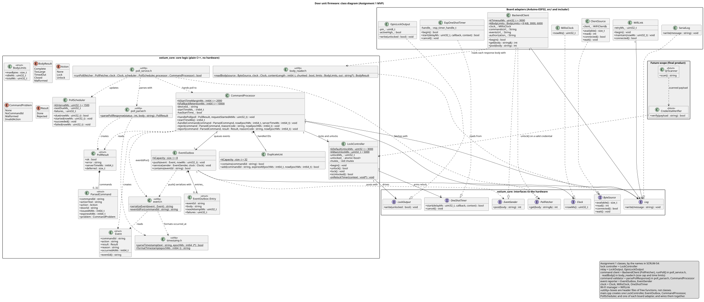
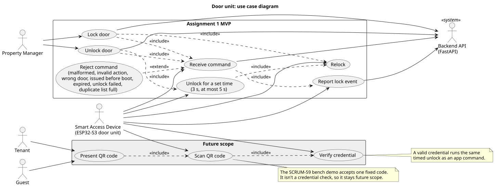

# Door unit design (Assignment 1)

This document explains how the door unit firmware is built and why. It's the firmware part of the Assignment 1 architecture and design rationale (SCRUM-56), and it holds the firmware class diagram (SCRUM-54) and use case diagram (SCRUM-55). The [lock command contract](lock-command-v0.md) defines the door's exact behavior, with rules R1 to R16, and this document refers to those rules by number.

- **Status:** the firmware compiles for the ESP32-S3, and all 54 unit tests pass on a laptop. It hasn't run on the board yet.
- **Version:** October 24, 2026.

## Architecture

The firmware has three layers. The core logic doesn't know it runs on an ESP32, and the board adapters don't make decisions.

| Layer | Where | What it does |
|---|---|---|
| Core logic | `hardware/esp32/lib/ostium_core/` | Plain C++ that decides when to lock and unlock, checks each command, queues events, and schedules polls. It includes no Arduino or ESP-IDF headers. |
| Interfaces | `interfaces.h` and `poll_service.h` in the core | Small abstract classes for everything the core needs from the hardware: the lock output, a clock, a one-shot timer, a log, and the two network calls. |
| Board adapters | `hardware/esp32/src/` and `hardware/esp32/include/` | The Arduino-ESP32 implementations of those interfaces, plus `main.cpp`, which creates one of each and wires them together. |

| Interface | What it stands for | Board adapter | Test fake |
|---|---|---|---|
| `LockOutput` | The GPIO that drives the relay | `GpioLockOutput` | `FakeLockOutput` |
| `OneShotTimer` | The relock timer | `EspOneShotTimer` (esp_timer) | `FakeTimer` |
| `Clock` | Milliseconds since startup | `MillisClock` (`millis()`) | `FakeClock` |
| `Log` | The serial log | `SerialLog` | `FakeLog` |
| `PollFetcher` | `GET /devices/{device_id}/commands` | `BackendClient` | `SlowFetcher` |
| `EventSender` | `POST /devices/{device_id}/events` | `BackendClient` | `FakeSender`, `BlockingSender` |

Keeping the drivers separate from the core logic has three benefits:

- **The whole core runs in tests on a laptop.** The 54 Unity tests use the fakes, so they need no board, network, or backend. They run in a few seconds, so every rule can have its own test.
- **The core can be checked against the real backend.** The replay tests run responses recorded from the FastAPI door routes through the same core code the board runs.
- **Hardware changes stay in the adapters.** A different board, a motor-driven lock, or a push connection in place of polling changes an adapter, not the safety logic.

### Class diagram

The source is [`diagrams/class-diagram.puml`](diagrams/class-diagram.puml), and [`firmware-class-diagram.png`](diagrams/firmware-class-diagram.png) is a copy for the report. The diagram shows the firmware's classes, interfaces, and data structs, with their key attributes and operations. It leaves out private helper structs, such as `DuplicateList::Entry`. SCRUM-54 names the classes by their roles, which map to the code like this:

| Role in SCRUM-54 | Classes |
|---|---|
| Lock controller | `LockController` |
| Relay | `LockOutput`, `GpioLockOutput` |
| Command client | `BackendClient` (as `PollFetcher`), `runPoll()` in `poll_service.h` |
| Command validator | `parsePollResponse()` in `poll_parser.h`, `CommandProcessor` |
| Event reporter | `EventOutbox`, `EventSender` |
| Clock | `Clock`, `MillisClock`, `OneShotTimer` |
| Wi-Fi manager | `WifiLink` |
| QR scanner, credential verifier (future scope) | `QrScanner`, `CredentialVerifier` |

`runPoll()`, `parsePollResponse()`, `parseTimestamp()`, `formatTimestamp()`, `serializeEvent()`, and `eventIdFor()` are free functions in the code. The diagram draws each header's free functions as a `<<utility>>` box named after the header, so their dependencies are visible.

SCRUM-54 also asks for the firmware classes in the team's class diagram. The repository doesn't have a team class diagram yet, so the firmware classes are only in this one. If the team assembles a combined diagram for the report, `firmware-class-diagram.png` is ready to include.

## How a command travels

1. A property manager presses **Unlock** in the app. The app sends `POST /api/v1/doors/{door_id}/commands` with the manager's token.
2. The FastAPI backend checks that the caller is a manager or an admin, stores the command in `access_events`, and returns `201`. The command expires 10 seconds after it's issued.
3. The door polls `GET /api/v1/devices/{device_id}/commands` every 1.5 seconds. `runPoll` records when the request starts, fetches the response, and hands it to `CommandProcessor`.
4. `CommandProcessor` runs the contract's checks in order and stops at the first failure: no usable command ID, already handled, duplicate list full, malformed, unknown action, wrong door, issued before the door started, and expired. If every check passes, it calls `LockController::unlock()` for an Unlock, which arms a 3-second relock timer and then turns the lock output on. For a Lock, it calls `LockController::lock()`, which cancels the timer and turns the output off.
5. The door posts one event for the command to `POST /api/v1/devices/{device_id}/events`. The backend then stops returning the command.
6. The relock timer fires and the door relocks, whether or not the event post has finished.

The contract has a [sequence diagram](lock-command-v0.md#how-a-command-travels) of the same flow.

### Why the door polls over HTTPS instead of using MQTT

Plan v2 has the door and the backend talk through an MQTT broker (section 4). For the MVP, the door polls the backend's REST routes over HTTPS instead:

- **There's one protocol and one server.** The FastAPI backend already serves the door routes as REST (PR #10), and the course favors RESTful APIs. HTTPS comes from whichever host runs the backend, and the backend isn't hosted yet. MQTT would need a broker with TLS and per-device authentication that someone has to host and run, and no one on the team owns that for Assignment 1.
- **The door doesn't depend on a long-lived connection.** Each poll is an ordinary outbound HTTPS request, so it works behind NAT and on campus Wi-Fi. The door reuses the connection between polls when it can, and if the connection drops, the next poll opens a new one. An MQTT client also connects outbound, but it has to keep its connection open, with keep-alive pings, to receive commands, and it has to detect and recover from a connection that drops silently.
- **Delay stays bounded.** While polls succeed, a command reaches the door within about 1.5 seconds plus the request time. After a failed poll, the door waits 2, 4, then 8 seconds, and a slow event post in the same loop can also hold up the next poll. Commands expire 10 seconds after the backend issues them, so the door never runs a command later than that. Plan v2's requirement R8 asks for a remote unlock within 3 seconds, so the MVP can meet R8 only while polls succeed. The bench test in SCRUM-52 measures the real delay.
- **Failures are simple.** Each poll stands alone. A failed poll backs off for 2, 4, then 8 seconds, and the door stays locked through every error.

Polling costs about 40 requests a minute per door, plus up to one poll interval of delay. A push channel, such as MQTT or Supabase Realtime, could replace polling later. Only the fetcher and the scheduler would change, and `CommandProcessor` and `LockController` would stay as they are.

### Use case diagram

The source is [`diagrams/use-case-diagram.puml`](diagrams/use-case-diagram.puml), and [`firmware-use-case-diagram.png`](diagrams/firmware-use-case-diagram.png) is a copy for the report.

- **The Assignment 1 MVP boundary holds the remote commands.** The property manager locks or unlocks the door through the backend API. The smart access device receives each command and checks it. For an Unlock that passes, the device unlocks the door for a set time and then relocks it. For a Lock that passes, it relocks the door right away. The device rejects a command that fails a check, and it reports each result as a lock event (R13).
- **The shaded Future scope boundary is the final product.** A tenant or guest presents a QR code, and the device scans it and verifies the credential. A valid credential would use the same timed unlock as an app command.

## Safety rules

The lock is fail-secure: it's locked whenever the lock output is off, as in plan v2 section 4.1. Every rule below keeps the door locked unless a valid command says otherwise.

| Rule | What the door does | How |
|---|---|---|
| Relay off at boot (R1) | The lock is locked from the first statement of `setup()`. | `LockController::begin()` runs first. `GpioLockOutput` sets the locked level before the pin becomes an output, and a pull resistor holds the level while the pin floats during boot. |
| Timed unlock (R9) | An unlock lasts 3,000 ms, then the door relocks. | `unlock()` arms the relock timer before it turns the output on. If the timer can't be armed, the door stays locked and reports `unlock_failed`. |
| Relock while busy (R12) | The relock fires on time even while the main loop is blocked in a network request. | The relock runs from an esp_timer callback in its own task. It shares a mutex with `unlock()` and `lock()`, because it runs on the other core. |
| Early lock (R11) | A Lock command relocks right away and cancels the timer. | `LockController::lock()` |
| Maximum unlock time (R10) | No unlock lasts more than 5,000 ms, and a second unlock doesn't extend the first. | The constructor clamps the unlock time, and `unlock()` does nothing while the door is already unlocked. |
| Never unlock on an error (R12, R16) | A network error, a bad response, or a `401` runs nothing. | `parsePollResponse` marks a bad response as failed, and `handlePoll` runs no commands from it. |
| No second unlock after a reset (R5) | A command issued before the door started is rejected. | The start time comes from the first poll's `server_time`, measured from the request start, plus a 2-second margin. |
| No stale or repeated commands (R3, R4) | An expired command, or one already handled, never runs. | `DuplicateList` keeps each command ID until the backend's clock passes its expiry. |

One limit is known. A panic or watchdog reset restarts the CPUs but not the GPIO, so an unlock that a crash interrupts lasts until the next boot reaches `setup()`. The SCRUM-52 bench test measures how long that takes.

## Authentication and authorization

- **The door has its own token.** Each door unit has a random token of at least 256 bits and sends it as a bearer token on every request. The backend stores only the token's lowercase hex SHA-256 digest, in `devices.credential_hash`, and compares digests in constant time. It accepts the door only while the device's status is `active` or `offline`, and it scopes each request to the device key in the path.
- **The connection is verified.** The door uses HTTPS and checks the server certificate against a configured root certificate. It never calls `setInsecure()`. Plain HTTP works only in the bench build, for a backend on a laptop. Until the backend is hosted, integration runs FastAPI on a laptop over plain HTTP with the bench build, so the device token crosses the bench network unencrypted.
- **The door holds nothing that can unlock other doors.** It never holds the Supabase service-role key or a user token. Its secrets live in `include/secrets.h`, which Git ignores.
- **Only managers can send commands.** The backend accepts `POST /doors/{door_id}/commands` only from a manager or an admin (`backend/app/routers/access.py`):
  - An unlock opens a real door, so only managers and admins can send one. The MVP checks only the role, so any active manager or admin can command every door ([API](../api.md)). Plan v2 also checks that the user is authorized for that door (section 5.4). That check is deferred to the final product.
  - The door runs any valid command the backend serves for its device key, so the backend is the only place that can check who's allowed.
  - The backend stores each command with the issuing user, so every remote unlock in the access log names a person, as plan v2 requires (sections 5.1 and 5.4).
  - Tenants and guests get their own credentials in the final product, through the QR flow.

## Hardware choice

The door unit is an ESP32-S3 board with an onboard camera. For Assignment 1, it drives a relay module, or an LED in its place (SCRUM-49). The final product adds plan v2's 12 V fail-secure solenoid (section 4.1), and the safety rules assume that fail-secure lock.

- **It handles TLS and JSON with room to spare.** The ESP32-S3 has built-in Wi-Fi, hardware acceleration for TLS cryptography, two cores, and 512 KB of SRAM. The current build uses 14.1% of RAM and 27.1% of flash.
- **It's ready for the final product.** The onboard camera can scan QR codes when they return (SCRUM-38), on the same board.
- **It's practical for the team.** It runs Arduino-ESP32 under PlatformIO, which builds and tests the firmware from the command line, and it's cheap and easy to get.

Plan v2 specified an AI-Thinker ESP32-CAM (section 4.1). The team didn't have one, so on October 19 Cameron ordered an ESP32-S3 board with an onboard camera instead. The S3 may also lower a risk in plan v2's register: ESP32-CAM memory and GPIO limits with the camera, TLS, and decoding all running at once (section 10). The S3 chip has more GPIO than the ESP32 (45 against 34) but slightly less internal SRAM (512 KB against 520 KB), so the memory headroom depends on the board's PSRAM. Its strapping pins differ (GPIO 0, 3, 45, and 46, not 0, 2, 12, and 15), so the firmware team picks the lock pin from the board's own pinout. SCRUM-49 hasn't recorded the exact board model yet, so the build uses a generic ESP32-S3 board ID.

## The MVP subset and what's deferred

**The MVP** is remote Lock and Unlock: a manager sends a command, the backend stores it, the door polls for it and drives the relay, and the door reports the result. The MVP spans all three modules (the app, the backend, and the door). The app's Lock and Unlock buttons aren't built yet, so until they are, you send commands with the [API walkthrough](../api.md#thursday-walkthrough).

**Deferred to the final product:**

- QR codes and camera scanning. The firmware has no camera code yet.
- Credential checks on the door, with signed and expiring credentials (SCRUM-38).
- Offline rules: unlocking with Wi-Fi down for 72 hours, and an offline log buffer.
- Configuration and revocation sync.
- The doorbell, snapshots, and push notifications.
- The RTC module.

**Why:** on October 19 the team agreed to move QR codes out of the MVP to meet the October 25 deadline. The QR path depends on work that wasn't ready: the camera decode bench test, which is plan v2's decision gate for the credential format (section 5.7), a key-distribution scheme, and backend credential routes. Remote commands could be built and tested end to end in the time available.

The fixed-QR proof of concept (SCRUM-59) is a bench demo only. It accepts one fixed code that never expires and can't be revoked, so it isn't a credential check.

## Changes from project plan v2

| Area | Plan v2 | Assignment 1 MVP | Why |
|---|---|---|---|
| What opens the door | A tenant's phone shows a QR code signed with Ed25519, and the door verifies it offline (sections 3, 4, and 5) | A manager sends Lock or Unlock from the app, through the backend | The team's scope decision of October 19. The QR path moves to the final product. |
| Door to backend | MQTT broker with TLS, retained messages, and QoS 1 (section 4) | HTTPS polling of the REST door routes every 1.5 seconds | One protocol and server, outbound-only requests, and no broker to host. See [Why the door polls over HTTPS](#why-the-door-polls-over-https-instead-of-using-mqtt). |
| Remote unlock security | The backend checks that the user is authorized for that door, signs each command with Ed25519, and the door checks a counter and its RTC time (section 5.4) | A per-device token over verified HTTPS, backend role checks (any active manager or admin, for any door), a 10-second expiry on the server's clock, duplicate checks, and the issued-before-boot check | The MVP has no RTC and no key distribution yet. TLS plus server-side role checks cover the online-only MVP. Per-door authorization is deferred. |
| Remote commands | Remote unlock only, in full scope for Sprint 2 (sections 3 and 5.4, requirement R8) | Remote Lock and Unlock are the MVP | Remote commands could be built and tested end to end by October 25. A Lock command ends an unlock early (contract rule R11), so a manager can relock without waiting for the timer. |
| Board | AI-Thinker ESP32-CAM with an OV2640 camera (section 4.1) | ESP32-S3 with an onboard camera | Availability. The S3 chip also has more GPIO. |
| Door secrets | The door stores only public keys, with flash encryption and secure boot on (section 5.6) | The door stores its device token and the Wi-Fi password in plain flash, with no flash encryption or secure boot | The MVP runs on a bench. Anyone who reads a stolen door's flash can poll and report events as that door, but can't unlock other doors. Flash encryption and secure boot are deferred to the final product. |
| Timekeeping | DS3231 RTC, corrected by NTP (section 4.1) | No RTC. The door estimates time from the backend's `server_time` (R4, R5) | The MVP is online-only, so the server's clock is enough. |
| Offline behavior | QR unlock works offline for 72 hours, and at least 1,000 events are buffered (R3, R4, section 4.2) | The door is online-only and stays locked while offline. Up to 8 events wait in RAM. | Offline rules are deferred with the QR path. |
| Events | Each event names a credential (R4) | Each event reports one command: its ID, the result, and a reason code | The MVP's commands come from managers and admins, and the backend stores each command with the user who sent it. |
| Unlock time | The relay fires for 3 seconds (section 5.3) | 3 seconds, with a 5-second hard maximum | The maximum guards against configuration mistakes (R10). |
| Doorbell | Button, snapshot, and push notification (R7) | Not in the MVP | Deferred. |

## Testing

- **Unit tests:** 54 Unity tests run on a laptop with `pio test -d hardware/esp32/native-tests`. Every rule from R1 to R16 has at least one test. For how to run them, see [Testing](../testing.md#firmware-unit-tests).
- **Replay tests:** 9 of those tests run responses recorded from the real FastAPI door routes through the core, and check that the firmware writes the exact event bodies the backend accepted.
- **Planted bugs:** during review, each bug planted one at a time in a copy of the core made at least one test fail.
- **Board build:** both board builds compile with the ESP32-S3 toolchain.
- **Bench tests (SCRUM-52):** boot and reset behavior, unlock timing over at least 20 unlocks, and the remote-unlock delay. These need the board.

## Known limits

- The firmware hasn't run on a board yet. The lock pin (GPIO 14) and the relay polarity are placeholders until the board model is recorded.
- An unlock interrupted by a crash lasts until the next boot reaches `setup()`, as described in [Safety rules](#safety-rules).
- Events wait in RAM, so an event that hasn't been delivered is lost if the door resets. If the backend still serves the command after the reset, the door reports it as `issued_before_boot`, which means the outcome is unknown. If the command has expired by then, the backend stops serving it, and the command has no report.
- SCRUM-62 plans to move the backend from FastAPI to Supabase Edge Functions. If that happens, the door routes must keep the same paths, bodies, and status codes, and the functions must accept the door's own token.
- The app doesn't have Lock and Unlock buttons yet. Until it does, you can send commands with the walkthrough in [API](../api.md#thursday-walkthrough).
