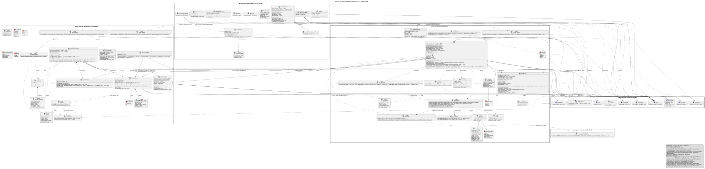
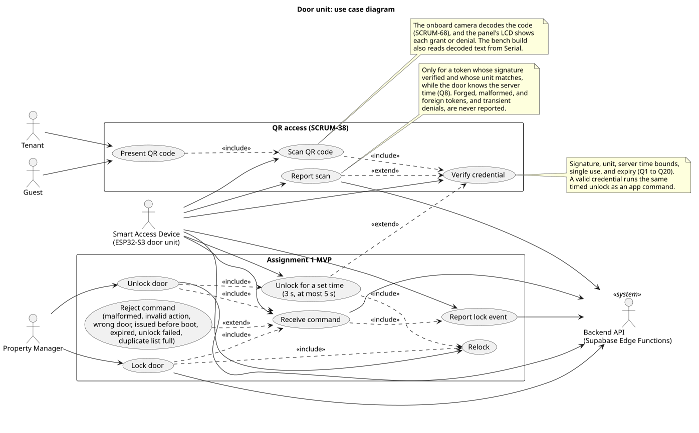

# Door unit design (Assignment 1)

This document explains how the door unit firmware is built and why. It's the firmware part of the Assignment 1 architecture and design rationale (SCRUM-56), and it holds the firmware class diagram (SCRUM-54) and use case diagram (SCRUM-55). The [lock command contract](lock-command-v0.md) defines the door's exact behavior for remote commands, with rules R1 to R16, and the [QR access contract](qr-access-v0.md) defines its local QR checks, with rules Q1 to Q20. This document refers to those rules by number.

- **Status:** the firmware compiles for the ESP32-S3, and all 122 unit tests pass on a laptop. It hasn't run on the board yet.
- **Version:** November 16, 2026.

## Architecture

The firmware has four layers. The core logic doesn't know it runs on an ESP32, and the board adapters don't make decisions.

| Layer | Where | What it does |
|---|---|---|
| Core logic | `hardware/esp32/lib/ostium_core/` | Plain C++ that decides when to lock and unlock, checks each command and each QR credential, keeps bounds on the server's clock, queues reports, and schedules polls. It includes no Arduino or ESP-IDF headers. |
| Interfaces | `interfaces.h` and `poll_service.h` in the core, and `QrFeedback` in `qr_access.h` | Small abstract classes for everything the core needs from the hardware: the lock output, a clock, a one-shot timer, a log, the network calls, a source of decoded QR codes, and feedback for each QR decision. |
| Vendored crypto | `hardware/esp32/lib/monocypher/` | Unmodified Monocypher 4.0.2, for the Ed25519 check on QR credentials. In the core, only `ed25519.cpp` calls it. |
| Board adapters | `hardware/esp32/src/` and `hardware/esp32/include/` | The Arduino-ESP32 implementations of those interfaces, plus `main.cpp`, which creates one of each and wires them together. |

| Interface | What it stands for | Board adapter | Test fake |
|---|---|---|---|
| `LockOutput` | The GPIO that drives the relay | `GpioLockOutput` | `FakeLockOutput` |
| `OneShotTimer` | The relock timer | `EspOneShotTimer` (esp_timer) | `FakeTimer` |
| `Clock` | Milliseconds since startup | `MillisClock` (`millis()`) | `FakeClock` |
| `Log` | The serial log | `SerialLog` | `FakeLog` |
| `PollFetcher` | `GET /devices/{device_id}/commands` | `BackendClient` | `SlowFetcher` |
| `EventSender` | `POST /devices/{device_id}/events`, and `POST /devices/{device_id}/qr-events` for QR reports | `BackendClient`, and `BackendClient::qrEvents()` for QR reports | `FakeSender`, `BlockingSender` |
| `ByteSource` | A response body as the network delivers it | `ClientSource` (`WiFiClient`) | `ScriptedSource` |
| `ScanSource` | Decoded QR codes waiting for the main loop | `CameraScanSource` (SCRUM-68), and `SerialScanSource` (bench build only) | `FakeScanSource` |
| `QrFeedback` | The LCD that shows each QR decision | `AccessPanel` (SCRUM-68) | `FakeFeedback` |

Keeping the drivers separate from the core logic has three benefits:

- **The whole core runs in tests on a laptop.** The 122 Unity tests use the fakes, so they need no board, network, or backend. They run in a few seconds, so every rule can have its own test.
- **The core can be checked against the real backend.** The replay tests run responses recorded from the former FastAPI door routes, and from the Deno QR and device routes, through the same core code the board runs.
- **Hardware changes stay in the adapters.** A different board, a motor-driven lock, or a push connection in place of polling changes an adapter, not the safety logic.

### Class diagram

The source is [`diagrams/class-diagram.puml`](diagrams/class-diagram.puml), and [`firmware-class-diagram.png`](diagrams/firmware-class-diagram.png) is a copy for the report. The rendered SVG and PNG predate SCRUM-38. To show the QR access and camera classes, render them again from the source, as its header comment describes. The diagram shows the firmware's classes, interfaces, and data structs, with their key attributes and operations. It leaves out private helper structs, such as `DuplicateList::Entry`. SCRUM-54 names the classes by their roles, which map to the code like this:

| Role in SCRUM-54 | Classes |
|---|---|
| Lock controller | `LockController` |
| Relay | `LockOutput`, `GpioLockOutput` |
| Command client | `BackendClient` (as `PollFetcher`), `runPoll()` in `poll_service.h`, and `readBody()` in `body_reader.h` with `ClientSource` (as `ByteSource`) |
| Command validator | `parsePollResponse()` in `poll_parser.h`, `CommandProcessor` |
| Event reporter | `EventOutbox` (one for command events and one for QR reports, set by `ReportKind`), `EventSender`, and `ReportScheduler`, which takes turns between the two queues |
| Clock | `Clock`, `MillisClock`, `OneShotTimer`, and `ServerClock` for the server time bounds |
| Wi-Fi manager | `WifiLink` |
| QR scanner | `ScanSource`, `CameraScanSource` with `scanFromCameraDecode()` in `camera_scan.h` (SCRUM-68), `SerialScanSource` with `SerialScanParser` (bench build), and `AccessPanel`, which runs the camera and shows each decision as a `QrFeedback` |
| Credential verifier | `QrAccess`, `verifyQrToken()` in `qr_token.h`, `verifyEd25519()` in `ed25519.h`, and `runQrSelfTest()` in `qr_self_test.h` |

`runPoll()`, `readBody()`, `parsePollResponse()`, `parseTimestamp()`, `formatTimestamp()`, `serializeEvent()`, `eventIdFor()`, `serializeQrReport()`, `qrEventIdFor()`, `verifyQrToken()`, `makeQrKey()`, `decodeBase64Url()`, `encodeBase64Url()`, `verifyEd25519()`, `runQrSelfTest()`, `drainScans()`, `qrSignalFor()`, and `scanFromCameraDecode()` are free functions in the code. The diagram draws each header's free functions as a `<<utility>>` box named after the header, so their dependencies are visible.

SCRUM-54 also asks for the firmware classes in the team's class diagram. The repository doesn't have a team class diagram yet, so the firmware classes are only in this one. If the team assembles a combined diagram for the report, `firmware-class-diagram.png` is ready to include.

## How a command travels

1. A property manager presses **Unlock** in the app. The app sends `POST /api/v1/doors/{door_id}/commands` with the manager's token.
2. The backend's `ostium-api` Edge Function checks that the caller is a manager or an admin, stores the command in `access_events`, and returns `201`. The command expires 10 seconds after it's issued.
3. The door polls `GET /api/v1/devices/{device_id}/commands` every 1.5 seconds. `runPoll` records when the request starts, fetches the response, and hands it to `CommandProcessor`.
4. `CommandProcessor` runs the contract's checks in order and stops at the first failure: no usable command ID, already handled, duplicate list full, malformed, unknown action, wrong door, issued before the door started, and expired. If every check passes, it calls `LockController::unlock()` for an Unlock, which arms a 3-second relock timer and then turns the lock output on. For a Lock, it calls `LockController::lock()`, which cancels the timer and turns the output off.
5. The door posts one event for the command to `POST /api/v1/devices/{device_id}/events`. The backend then stops returning the command.
6. The relock timer fires and the door relocks, whether or not the event post has finished.

The contract has a [sequence diagram](lock-command-v0.md#how-a-command-travels) of the same flow.

### Why the door polls over HTTPS instead of using MQTT

Plan v2 has the door and the backend talk through an MQTT broker (section 4). For the MVP, the door polls the backend's REST routes over HTTPS instead:

- **There's one protocol and one server.** The backend serves the door routes as REST, first from FastAPI (PR #10) and now from the Supabase `device-api` Edge Function, and the course favors RESTful APIs. HTTPS comes from the host that runs the backend, now Supabase. MQTT would need a broker with TLS and per-device authentication that someone has to host and run, and no one on the team owns that for Assignment 1.
- **The door doesn't depend on a long-lived connection.** Each poll is an ordinary outbound HTTPS request, so it works behind NAT and on campus Wi-Fi. The door reuses the connection between polls when it can, and if the connection drops, the next poll opens a new one. An MQTT client also connects outbound, but it has to keep its connection open, with keep-alive pings, to receive commands, and it has to detect and recover from a connection that drops silently.
- **Delay stays bounded.** While polls succeed, a command reaches the door within about 1.5 seconds plus the request time. After a failed poll, the door waits 2, 4, then 8 seconds, and a slow event post in the same loop can also hold up the next poll. Commands expire 10 seconds after the backend issues them, so the door never runs a command later than that. Plan v2's requirement R8 asks for a remote unlock within 3 seconds, so the MVP can meet R8 only while polls succeed. The bench test in SCRUM-52 measures the real delay.
- **Failures are simple.** Each poll stands alone. A failed poll backs off for 2, 4, then 8 seconds, and the door stays locked through every error.

Polling costs about 40 requests a minute per door, plus up to one poll interval of delay. A push channel, such as MQTT or Supabase Realtime, could replace polling later. Only the fetcher and the scheduler would change, and `CommandProcessor` and `LockController` would stay as they are.

### Use case diagram

The source is [`diagrams/use-case-diagram.puml`](diagrams/use-case-diagram.puml), and [`firmware-use-case-diagram.png`](diagrams/firmware-use-case-diagram.png) is a copy for the report. The rendered SVG and PNG predate SCRUM-38. To show the QR access boundary, render them again from the source.

- **The Assignment 1 MVP boundary holds the remote commands.** The property manager locks or unlocks the door through the backend API. The smart access device receives each command and checks it. For an Unlock that passes, the device unlocks the door for a set time and then relocks it. For a Lock that passes, it relocks the door right away. The device rejects a command that fails a check, and it reports each result as a lock event (R13).
- **The QR access boundary (SCRUM-38) holds the local QR checks.** A tenant or guest presents a QR code, and the device scans it and verifies the credential. It reports the scan only when the token's signature verified, the token is for this door's unit, and the door knows the server's time (Q8). It never reports a forged, malformed, or foreign token, or a transient denial. A valid credential uses the same timed unlock as an app command. The camera decodes each code (SCRUM-68), and the bench build also reads decoded text from Serial.

## QR access

SCRUM-38 adds plan v2's main path: a tenant's phone shows a signed QR code, and the door checks it by itself. The [QR access contract](qr-access-v0.md) defines the exact behavior, and has a [sequence diagram](qr-access-v0.md#how-a-qr-scan-travels) of the flow.

1. A scan source queues each decoded text with the time its decode finished. `CameraScanSource` reads the camera task's decodes (SCRUM-68). In the bench build, `SerialScanSource` also reads `qr <token>` lines from Serial.
2. `loop()` hands up to 4 waiting scans from each source to `QrAccess::handleScan`, before and after each poll, and while offline.
3. `QrAccess` ignores stale decodes and repeats, then runs its checks in order and stops at the first failure.
4. For a valid credential, it calls `LockController::unlock()`, the same timed unlock as an app command, and queues one `granted` report. After every decision, `AccessPanel` shows it on the LCD: granted, denied, or please wait for a transient denial. An ignored decode shows nothing. The LED that stands in for the lock relay lights for the unlock itself.
5. `ReportScheduler` posts at most one report per loop pass across both queues, QR reports first, to `POST /devices/{device_id}/qr-events`. After a QR post that will be retried, command events go first until one posts, so neither queue can starve the other.

### Trust model

- **The backend signs, and the door checks.** The backend signs each credential with an Ed25519 private key that only it holds. The door stores only the matching public key, its unit's UUID, and the expected key ID, issuer, and audience, all set at build time.
- **Nothing unsigned is parsed.** The door pins the token's header byte for byte, verifies the signature over the exact text it received, and only then parses the claims. So a forged token, or one for another unit, never unlocks the door and never names a credential in a report (Q8).
- **The backend checks the people and the binding.** It checks the tenant's access grant when it issues a credential. When it records a report, it checks that the reporting device belongs to the credential's unit, and answers `403` otherwise.
- **A refused device stops.** When a poll gets `401`, the backend refuses this device's token or status, so the door stops QR access until a poll succeeds (Q11).

### Why Monocypher

Arduino-ESP32 2.0.17's mbedTLS has no Ed25519, and libsodium ships only in the board SDK, not on a laptop or the CI runner. So the firmware vendors Monocypher 4.0.2, unmodified and pinned by hash, in `hardware/esp32/lib/monocypher/`:

- **The tests check the board's verifier.** The board and the native tests compile the same files, so CI checks the real verifier against the RFC 8032 vectors, the backend's Python fixture, and tokens from the real Deno handler. With libsodium on the board and a fake in the tests, CI would never verify a real signature.
- **It needs no setup.** Nothing is installed on a laptop or in CI. Its license, BSD-2-Clause or CC0-1.0, fits the repository's MIT license.
- **It's strict.** It rejects non-canonical signatures (S ≥ L). TweetNaCl's `crypto_sign_open` doesn't check S, so it accepts them.
- **It's small.** It adds 14,602 bytes of flash.

Two caveats apply:

- **The audit predates the signature code.** Cure53 audited Monocypher 3 in June 2020, and release 3.1.2 addressed the findings. Release 4.0.0 reworked the signature API, so the 4.0.2 signature check that the door runs came after that audit. The evidence for that check is the RFC 8032 vectors, the S ≥ L test, and the CI checks against the backend's tokens.
- **The check is cofactored.** It multiplies by 8, so under a small-order public key, one fixed signature verifies over every message. `makeQrKey` runs that signature once against the configured key, and refuses any key that accepts it.

### Time without a real-time clock

The door has no RTC, so `ServerClock` keeps a lower and an upper bound on the server's clock (Q10):

- Each good poll brackets the backend's `server_time` stamp between the request start and the response arrival, and intersects that window with the bounds carried from earlier polls.
- Between polls, the bounds widen by 50 ppm of the local time that passed. Espressif's [ESP32-S3 hardware design guidelines](https://docs.espressif.com/projects/esp-hardware-design-guidelines/en/latest/esp32s3/schematic-checklist.html) call for the crystal to be within ±10 ppm, and 802.11 allows ±25 ppm in the 2.4 GHz band, so 50 ppm leaves at least twice the Wi-Fi tolerance. That's an assumption about the parts, which a working Wi-Fi link doesn't prove.
- At 50 ppm, 72 hours offline widens the bounds by 25,920 ms, under the 30-second cap. So QR access works for up to 72 hours after the last good poll, as plan v2 asks. After that, the door denies with `clock_unsynced` until a poll succeeds.
- A grant needs the latest possible server time before the expiry, and the earliest possible time minus 500 ms after the issue time. So any error in the bounds makes the door deny, never grant.
- The door reads its clock for those checks after the signature check, the slowest step, so the expiry check holds when the relay switches, not only when the scan arrived.

### Single use and the boot watermark

The door remembers each granted `jti` until the earliest possible server time, minus 500 ms, passes its expiry, and for at least 61 seconds on its own clock, in a 32-entry list that never drops an ID early (Q13). The time bounds can move backward when a poll restarts them, after a step in the server's clock or an answer from a slower instance. The 61 seconds outlast every code's lifetime, and the 500 ms covers the skew between instances. So a restart while the door still holds the `jti`, whether a slower instance answered or the server's clock stepped, can't make a used code valid again. The door forgets IDs by the bounds it holds, so a restart after it forgot the `jti` can. That includes a step during the code's life that the door saw only then, because it was offline or its polls failed, as the contract's [known limits](qr-access-v0.md#known-limits) describe. A reset clears that list, so the door also keeps a boot watermark: the latest possible server time at boot, plus 1 second, from the first good poll after boot. It denies any credential issued before the watermark (Q14). A code used before a reset was issued before it, so a reset can't make the code work twice. That's also why QR access waits for a good poll after every reboot.

### Startup self-test

`QrAccess::begin()` runs the backend fixture's token through the full verifier on the board, with the same Ed25519 check that every scan uses, and checks that two one-character changes fail. If any check fails, QR access stays off. It logs how long the fixture's own check took, which is what one scan costs, and `main.cpp` then logs the loop task's free stack. The [bench procedure](qr-access-v0.md#bench-procedure) records both: one check must take 100 ms or less, with at least 2 KB of stack free.

### QR reports

QR reports go in their own 8-entry outbox (`ReportKind::Qr`), so QR traffic never evicts a command event. Grants can't be dropped to make room, but denials can. Each credential gets at most one granted report, and at most one denied report while the door remembers the denial, which is at least 120 seconds. `occurred_at` is the earliest possible server time minus 500 ms, which the backend's checks always accept for a valid grant. On `qr-events`, a `403` means the device's unit doesn't match the credential's, so the door drops the report instead of retrying.

## Safety rules

The lock is fail-secure: it's locked whenever the lock output is off, as in plan v2 section 4.1. Every rule below keeps the door locked unless a valid command or QR credential says otherwise.

| Rule | What the door does | How |
|---|---|---|
| Relay off at boot (R1) | The lock is locked from the first statement of `setup()`. | `LockController::begin()` runs first. `GpioLockOutput` sets the locked level before the pin becomes an output, and a pull resistor holds the level while the pin floats during boot. Each later write makes the pin an output again, and `setup()` writes the locked level again after the camera starts, so a library that reconfigures the pin can't leave the lock undriven. |
| Timed unlock (R9) | An unlock lasts 3,000 ms, then the door relocks. | `unlock()` arms the relock timer before it turns the output on. If the timer can't be armed, the door stays locked and reports `unlock_failed`. |
| Relock while busy (R12) | The relock fires on time even while the main loop is blocked in a network request. | The relock runs from an esp_timer callback in its own task. It shares a mutex with `unlock()` and `lock()`, because it runs on the other core. |
| Early lock (R11) | A Lock command relocks right away and cancels the timer. | `LockController::lock()` |
| Maximum unlock time (R10) | No unlock lasts more than 5,000 ms, and a second unlock doesn't extend the first. | The constructor clamps the unlock time, and `unlock()` does nothing while the door is already unlocked. |
| Never unlock on an error (R12, R16) | A network error, a bad response, or a `401` runs nothing. A response body that stops arriving ends the request instead of blocking the loop. | `parsePollResponse` marks a bad response as failed, and `handlePoll` runs no commands from it. `readBody` ends a body after 3 seconds with no byte, or 6 seconds in all, and the poll counts as failed. |
| No second unlock after a reset (R5) | A command issued before the door started is rejected. | The start time comes from the first poll's `server_time`, measured from the request start, plus a 2-second margin. |
| No stale or repeated commands (R3, R4) | An expired command, or one already handled, never runs. | `DuplicateList` keeps each command ID until the backend's clock passes its expiry. |
| Only valid QR codes unlock (Q2 to Q17) | A QR code unlocks only if its signature verifies with the backend's public key, it's for this door's unit, it hasn't been used at this door, and the server time bounds show it's valid. | `QrAccess` runs its checks in a fixed order and stops at the first failure. Its time comes only from `ServerClock`'s bounds, which err toward denying. |
| No QR replay after a reset (Q14) | A QR code issued before the door started is denied. | The boot watermark is the latest possible server time at boot, plus 1 second, from the first good poll. |

One limit is known. A panic or watchdog reset restarts the CPUs but not the GPIO, so an unlock that a crash interrupts lasts until the next boot reaches `setup()`. The SCRUM-52 bench test measures how long that takes.

## Authentication and authorization

- **The door has its own token.** Each door unit has a random token of at least 256 bits and sends it as a bearer token on every request. The backend stores only the token's lowercase hex SHA-256 digest, in `devices.credential_hash`, and compares digests in constant time. It accepts the door only while the device's status is `active` or `offline`, and it scopes each request to the device key in the path.
- **The connection is verified.** The door uses HTTPS and checks the server certificate against a configured root certificate. It never calls `setInsecure()`. Plain HTTP works only in the bench build, for a mock on a laptop, and a bench run over plain HTTP sends the device token across the bench network unencrypted. The Supabase functions serve HTTPS, so the [bench procedure](qr-access-v0.md#bench-procedure) uses HTTPS.
- **The door holds nothing that can unlock other doors.** It never holds the Supabase service-role key or a user token. For QR access, it holds only the backend's public key, which can check credentials but can't sign them. Its secrets live in `include/secrets.h`, which Git ignores.
- **Only managers can send commands.** The backend accepts `POST /doors/{door_id}/commands` only from a manager or an admin (`backend/supabase/functions/_shared/api.ts`):
  - An unlock opens a real door, so only managers and admins can send one. The MVP checks only the role, so any active manager or admin can command every door ([API](../api.md)). Plan v2 also checks that the user is authorized for that door (section 5.4). That check is deferred to the final product.
  - The door runs any valid command the backend serves for its device key, so the backend is the only place that can check who's allowed.
  - The backend stores each command with the issuing user, so every remote unlock in the access log names a person, as plan v2 requires (sections 5.1 and 5.4).
  - Tenants get their own credentials through the QR flow. The backend checks the tenant's access grant when it issues each credential, and the door checks the credential itself. See [QR access](#qr-access).

## Hardware choice

The door unit is an ESP32-S3 board with an onboard camera. For Assignment 1, it drives a relay module, or an LED in its place (SCRUM-49). The final product adds plan v2's 12 V fail-secure solenoid (section 4.1), and the safety rules assume that fail-secure lock.

- **It handles TLS and JSON with room to spare.** The ESP32-S3 has built-in Wi-Fi, hardware acceleration for TLS cryptography, two cores, and 512 KB of SRAM. With QR access and the camera, the `esp32s3` build uses 16.1% of RAM and 31.1% of flash. [Testing](#testing) has the exact figures.
- **It's ready for the final product.** The door already checks QR credentials (SCRUM-38), and the onboard camera can scan them on the same board (SCRUM-68).
- **It's practical for the team.** It runs Arduino-ESP32 under PlatformIO, which builds and tests the firmware from the command line, and it's cheap and easy to get.

Plan v2 specified an AI-Thinker ESP32-CAM (section 4.1). The team didn't have one, so on October 19 Cameron ordered an ESP32-S3 board with an onboard camera instead. The S3 may also lower a risk in plan v2's register: ESP32-CAM memory and GPIO limits with the camera, TLS, and decoding all running at once (section 10). The S3 chip has more GPIO than the ESP32 (45 against 34) but slightly less internal SRAM (512 KB against 520 KB), so the memory headroom depends on the board's PSRAM. Its strapping pins differ (GPIO 0, 3, 45, and 46, not 0, 2, 12, and 15), so the firmware team picks the lock pin from the board's own pinout. SCRUM-49 hasn't recorded the exact board model yet, so the build uses a generic ESP32-S3 board ID.

## The MVP subset and what's deferred

**The MVP** is remote Lock and Unlock: a manager sends a command, the backend stores it, the door polls for it and drives the relay, and the door reports the result. The MVP spans all three modules (the app, the backend, and the door). The app's Lock and Unlock buttons aren't built yet, so until they are, you send commands with the [API walkthrough](../api.md#thursday-walkthrough).

**Done after the MVP:** credential checks on the door, with signed and expiring credentials (SCRUM-38). The door verifies each QR credential itself, unlocks for a valid one, reports the result, and keeps working with Wi-Fi down for up to 72 hours. The camera feeds those checks, and the access panel shows each decision (SCRUM-68). See [QR access](#qr-access).

**Deferred to the final product:**

- An offline log buffer. Command events and QR reports wait in RAM, 8 of each.
- Configuration and revocation sync. The door's unit and the public key are set at build time, and no revocation feed reaches the door.
- The doorbell, snapshots, and push notifications.
- The RTC module.

**Why:** on October 19 the team agreed to move QR codes out of the MVP to meet the October 25 deadline. The QR path depends on work that wasn't ready: the camera decode bench test, which is plan v2's decision gate for the credential format (section 5.7), a key-distribution scheme, and backend credential routes. Remote commands could be built and tested end to end in the time available.

Signed credentials replace the fixed-QR proof of concept (SCRUM-59), a bench demo that accepted one fixed code that never expired and couldn't be revoked.

## Changes from project plan v2

The third column describes the firmware now: the Assignment 1 MVP, plus the QR access that SCRUM-38 added.

| Area | Plan v2 | Current firmware | Why |
|---|---|---|---|
| What opens the door | A tenant's phone shows a QR code signed with Ed25519, and the door verifies it offline (sections 3, 4, and 5) | A manager sends Lock or Unlock from the app, through the backend. A tenant's phone also shows a QR code signed with Ed25519, and the door verifies it itself (SCRUM-38). The onboard camera decodes the code (SCRUM-68), and the bench build also reads decoded text from Serial. | The team's scope decision of October 19 made remote commands the MVP. SCRUM-38 then added the QR path, and SCRUM-68 connected the camera to it. |
| Door to backend | MQTT broker with TLS, retained messages, and QoS 1 (section 4) | HTTPS polling of the REST door routes every 1.5 seconds | One protocol and server, outbound-only requests, and no broker to host. See [Why the door polls over HTTPS](#why-the-door-polls-over-https-instead-of-using-mqtt). |
| Remote unlock security | The backend checks that the user is authorized for that door, signs each command with Ed25519, and the door checks a counter and its RTC time (section 5.4) | A per-device token over verified HTTPS, backend role checks (any active manager or admin, for any door), a 10-second expiry on the server's clock, duplicate checks, and the issued-before-boot check | The MVP has no RTC and no key distribution yet. TLS plus server-side role checks cover the online-only MVP. Per-door authorization is deferred. |
| Remote commands | Remote unlock only, in full scope for Sprint 2 (sections 3 and 5.4, requirement R8) | Remote Lock and Unlock are the MVP | Remote commands could be built and tested end to end by October 25. A Lock command ends an unlock early (contract rule R11), so a manager can relock without waiting for the timer. |
| Board | AI-Thinker ESP32-CAM with an OV2640 camera (section 4.1) | ESP32-S3 with an onboard camera | Availability. The S3 chip also has more GPIO. |
| Door secrets | The door stores only public keys, with flash encryption and secure boot on (section 5.6) | The door stores its device token and the Wi-Fi password in plain flash, with no flash encryption or secure boot. For QR access, it stores only the backend's public key. | The MVP runs on a bench. Anyone who reads a stolen door's flash can poll and report events as that door, but can't unlock other doors. Flash encryption and secure boot are deferred to the final product. |
| Timekeeping | DS3231 RTC, corrected by NTP (section 4.1) | No RTC. Commands use the backend's `server_time` (R4, R5). QR access keeps a lower and an upper bound on the server's clock from each poll's request and response times, widened by 50 ppm of drift between polls (Q10). | Commands need the backend anyway, so its clock is enough for them. The bounds let QR access check expiry safely for 72 hours offline without an RTC. |
| Offline behavior | QR unlock works offline for 72 hours, and at least 1,000 events are buffered (R3, R4, section 4.2) | Commands need the backend. QR access works offline for up to 72 hours after the last good poll, but never after a reboot until a poll succeeds. Up to 8 command events and 8 QR reports wait in RAM. | The 72 hours meets plan v2. The QR path needs one good poll after boot for single use to survive a reset (Q14). The event buffer is deferred. |
| Events | Each event names a credential (R4) | Each command event reports one command: its ID, the result, and a reason code. Each QR report names the credential, with the result and a reason code. | The MVP's commands come from managers and admins, and the backend stores each command with the user who sent it. The backend links each QR report to the credential's user. |
| Unlock time | The relay fires for 3 seconds (section 5.3) | 3 seconds, with a 5-second hard maximum | The maximum guards against configuration mistakes (R10). |
| Doorbell | Button, snapshot, and push notification (R7) | Not in the MVP | Deferred. |

## Testing

- **Unit tests:** 122 Unity tests run on a laptop with `pio test -d hardware/esp32/native-tests`. Every rule from R1 to R16 and from Q1 to Q20 has at least one test. For how to run them, see [Testing](../testing.md#firmware-unit-tests).
- **Replay tests:** 16 of those tests run responses recorded from a real backend through the core:
  - 9 use historical responses from the removed FastAPI door routes, and check that the firmware writes the exact event bodies that backend accepted. Those fixtures can't be recorded again.
  - 7 use tokens and responses from the Deno QR and device routes. They check that the door grants a token the backend issued, that the backend accepts every QR report body the firmware writes, and that it refuses grants outside a credential's window. 2 of the 7 are for the production-clock set, recorded on the backend's default clock, so their times are whole milliseconds, as in real tokens. They check the door's earliest grants, 2 ms and 1 ms after `issued_at`, and its latest grant, just before `expires_at`. The response-table test also replays that set's 5 reports. The capture tool computes the set's Q6 values with a copy of ArduinoJson 7.4.3's parse and IEEE double arithmetic, as the firmware does, because the parse doesn't always give the nearest double. The build files pin ArduinoJson to exactly 7.4.3, and the tool and the replay tests fail on any other release.
- **Fixture check:** CI runs `hardware/esp32/tools/capture_qr_backend.ts --check`, which fails if the QR replay headers no longer match the Deno backend.
- **Planted bugs:** during review, each bug planted one at a time in a copy of the core made at least one test fail. SCRUM-38 repeated this for the QR code with more than 50 planted bugs, and every one that changed behavior made a test fail.
- **Board build:** both board builds compile with the ESP32-S3 toolchain:
  - `esp32s3`: 52,860 bytes of RAM (16.1%) and 1,040,061 bytes of flash (31.1%).
  - `esp32s3-bench`: 52,900 bytes of RAM (16.1%) and 1,041,501 bytes of flash (31.2%).
  - Monocypher is 14,602 bytes of each. Both builds drain the camera into `QrAccess`, so both hold the QR decision code. The bench build adds the serial QR input.
- **Bench tests (SCRUM-52):** boot and reset behavior, unlock timing over at least 20 unlocks, and the remote-unlock delay. The QR access contract's [bench procedure](qr-access-v0.md#bench-procedure) also measures the Ed25519 check time and the free stack. These need the board.

## Known limits

- The firmware hasn't run on a board yet. The lock pin (GPIO 14) and the relay polarity are placeholders until the board model is recorded. The team has no lock yet, so an LED on GPIO 14 stands in for the relay. Only `LockController` drives it, so it lights for each unlock, and only the LCD shows grants and denials. No bench run has confirmed that the LED lights for each unlock with the camera running, or that the camera decodes a full token at QVGA. See the contract's [camera handoff](qr-access-v0.md#camera-handoff-scrum-68).
- An unlock interrupted by a crash lasts until the next boot reaches `setup()`, as described in [Safety rules](#safety-rules), so it can last longer than the 5-second maximum (R10). Firmware can't bound it, because the relock timer stops with the CPU. Only a hardware cutoff that turns the lock off without the CPU, such as a timer relay, can. That's for the final product, and the SCRUM-52 bench test measures how long it lasts today.
- A command rejected with `duplicate_cache_full` is remembered only while its rejection event waits in the event queue. If all 32 places in the duplicate list hold unexpired commands, 9 more rejections push the first one out of the 8-event queue. If its event was never delivered, and the backend serves that command again after a place frees up, the door runs it. This needs more than 32 live commands within one 10-second expiry window, plus failed event posts. Keeping rejected IDs separate from the event queue would close it.
- Arduino-ESP32 2.0.17 builds mbedTLS without certificate date checks (`CONFIG_MBEDTLS_HAVE_TIME_DATE` is off), and the door has no wall clock. So the door accepts an expired or not-yet-valid certificate for the backend's host if it chains to the configured root. Fixing this needs an SDK build with date checks and a trusted time source, such as SNTP, before the first HTTPS poll. The bench build uses plain HTTP, so it has no TLS at all.
- Poll and event-retry deadlines use 32-bit `millis()` arithmetic, which is valid for about 24.8 days. If Wi-Fi stays down longer than that, an overdue poll can look as if it's due up to 24.8 days later, and polling stalls until then. A 64-bit clock, or making polls and retries due when Wi-Fi returns, would fix it.
- QR access has its own known limits, listed in the [QR access contract](qr-access-v0.md#known-limits). The main ones: no revocation feed reaches the door, so a revoked credential opens the door until it expires, within 60 seconds; single use is per door; after a reboot, QR access waits for a good poll; and offline validation stops 72 hours after the last good poll.
- Events wait in RAM, so an event that hasn't been delivered is lost if the door resets. If the backend still serves the command after the reset, the door reports it as `issued_before_boot`, which means the outcome is unknown. If the command has expired by then, the backend stops serving it, and the command has no report.
- The backend now runs as Supabase Edge Functions, and FastAPI is removed. `device-api` serves the door routes with the paths and bodies in the [lock command contract](lock-command-v0.md), and checks the door's own token itself, with the platform's JWT check off. No test runs the board against a deployed function yet. The command replay tests replay historical FastAPI responses, and the Deno handler tests check the functions without a board.
- The app doesn't have Lock and Unlock buttons yet. Until it does, you can send commands with the walkthrough in [API](../api.md#thursday-walkthrough).
