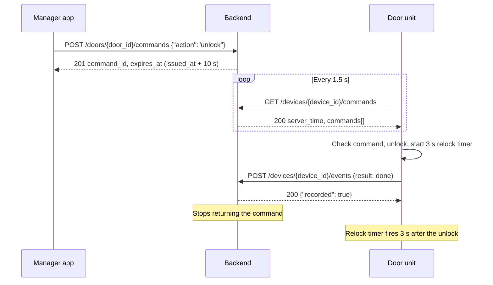

# Lock command contract (v0)

This document defines how the door unit receives Lock and Unlock commands from the backend, what it does with each command, and how it reports the result. It's the firmware side of SCRUM-48. The device routes are the FastAPI routes from SCRUM-60, described in [API](../api.md).

- **Status:** matches the FastAPI door routes merged in PR #10 (SCRUM-60). For review by the firmware owners.
- **Version:** 0, updated October 22, 2026.
- **Applies to:** the Assignment 1 MVP (due October 25, 2026).

## Scope

In scope:

- A manager presses **Lock** or **Unlock** in the app. The backend stores the command, and the door polls for it over HTTPS.
- The door checks each command, drives the lock, and reports one event per command.
- The fixed-QR proof of concept (SCRUM-59) uses the same unlock path as an app command. See [Fixed-QR proof of concept](#fixed-qr-proof-of-concept).

Out of scope for v0, and planned for the final product:

- Signed, expiring QR credentials checked on the door (SCRUM-38).
- Configuration sync, revocation data, doorbell events, and snapshot upload.
- Offline access rules.

For the MVP, this contract replaces the QR-era Device API. It drops `/devices/{device_id}/config` and `/devices/{device_id}/snapshots`, and it changes the body of `/devices/{device_id}/events`.

Because the backend is now in the unlock path, this contract departs from the trust boundary in [Architecture](../architecture.md) and the local-validation and offline items in [Requirements](../requirements.md). Those documents still describe the QR design for the final product. [Security](../security.md) now allows remote Lock and Unlock commands from active managers and admins.

## Firmware platform

- **Framework:** Arduino-ESP32 on PlatformIO.
- **Board:** ESP32-S3 with an onboard camera. The firmware team sets the PlatformIO board ID after it records the exact model (SCRUM-49).
- **Lock:** the rules assume a fail-secure lock that's locked when its output is off, such as a solenoid on a relay. A motor-driven lock needs different rules.
- **Core logic:** plain C++ that doesn't include `Arduino.h`. The lock output, clock, timer, and network sit behind interfaces, so the Unity tests run on a laptop with `pio test -d hardware/esp32/native-tests` (SCRUM-51). The tests don't need a board or a backend.
- **Libraries:** ArduinoJson 7 for JSON, and `HTTPClient` with `WiFiClientSecure` for HTTPS.

In this document, the *lock controller* is the core logic that decides when to lock and unlock, and the *lock output* is the GPIO pin that drives the relay or lock.

## How a command travels

1. The manager presses **Unlock**. The app sends `POST /api/v1/doors/{door_id}/commands`.
2. The backend stores the command with a 10-second expiry and returns `201`. That response means the command is queued, not that the door unlocked.
3. The door polls `GET /api/v1/devices/{device_id}/commands` every 1.5 seconds.
4. The door checks the command, unlocks, and starts its 3-second relock timer.
5. The door posts one event for the command.
6. The relock timer fires and the door relocks, whether or not the event post has finished.
7. The backend stops returning the command once it has an event.



## Configuration

The firmware build reads these values from `hardware/esp32/include/secrets.h`, which Git ignores. To configure a door unit, copy `hardware/esp32/include/secrets.example.h` to `secrets.h` in the same folder, and then replace the placeholders with the bench values. Settings that aren't secret, such as the lock GPIO and the unlock time, are in `hardware/esp32/include/board_config.h`.

| Setting | Meaning | Example |
|---|---|---|
| `OSTIUM_API_ROOT` | Full device API root, including the version prefix, with no trailing slash | `https://api.example.com/api/v1` |
| `OSTIUM_DEVICE_ID` | This door unit's `devices.device_key`, the text key the backend uses as `{device_id}` in the request path. It isn't `devices.id`. The backend also uses it as the `door_id`, in the app's command route and in every command. | `door-unit-01` |
| `OSTIUM_DEVICE_TOKEN` | This door unit's own secret, sent as a bearer token | Provided by the backend owner, never committed |
| `OSTIUM_ROOT_CA` | PEM root certificate of the backend host | The CA for the deployed host |
| `OSTIUM_WIFI_SSID`, `OSTIUM_WIFI_PASSWORD` | Wi-Fi network | Bench network |
| `OSTIUM_QR_ACCESS_VALUE` | Text the fixed-QR proof of concept accepts. If it's empty, QR unlock is off. | The value in the app's placeholder QR |
| `OSTIUM_ALLOW_PLAIN_HTTP` | Build flag that allows an `http://` API root. The `esp32s3-bench` environment defines it, for the local mock or FastAPI on a laptop. | Not defined |

These are the `OSTIUM_API_ROOT` forms:

| Backend | `OSTIUM_API_ROOT` |
|---|---|
| FastAPI service | `https://<host>/api/v1` |
| FastAPI on a bench laptop, started with `uvicorn app.main:app --host 0.0.0.0` | `http://<laptop LAN IP>:8000/api/v1` |
| Local mock on the bench network | `http://<laptop LAN IP>:<port>/api/v1` |

SCRUM-62 plans to replace FastAPI with Supabase Edge Functions. If it does, `OSTIUM_API_ROOT` becomes the function URL, for example `https://<project-ref>.supabase.co/functions/v1/<function>/api/v1`. The functions must be deployed with JWT verification off (`--no-verify-jwt`), because the door's bearer token isn't a Supabase JWT. The paths, bodies, and status codes in this document must stay the same.

The firmware removes a trailing slash from `OSTIUM_API_ROOT` and adds only `/devices/{device_id}/commands` or `/devices/{device_id}/events`. It doesn't follow redirects.

## Device authentication

- Each request sends `Authorization: Bearer <OSTIUM_DEVICE_TOKEN>`.
- The token is a random secret of at least 256 bits, unique to the door unit. The backend stores only its lowercase hex SHA-256 digest, in `devices.credential_hash`. For how to create one, see [backend setup](../../backend/readme.md).
- The backend accepts the door only while its `devices.status` is `active` or `offline`. An unknown device, a wrong token, or any other status, including the default `provisioned`, gets `401` on every request, and the door stays locked.
- The door never holds the Supabase service-role key or a user token.
- The door uses HTTPS and verifies the server certificate against `OSTIUM_ROOT_CA`. The firmware never calls `setInsecure()`.
- The firmware accepts an `http://` API root only in a build with `OSTIUM_ALLOW_PLAIN_HTTP` defined. Without that flag, the door doesn't poll, and it logs the reason.
- The door doesn't send an `Origin` header.

## Poll for commands

To check for commands, the door sends this request:

```http
GET {OSTIUM_API_ROOT}/devices/{device_id}/commands
Authorization: Bearer <device token>
```

The backend returns `200` with the unexpired commands that this device hasn't reported yet, oldest first:

```json
{
  "server_time": "2026-10-22T15:00:01.200Z",
  "commands": [
    {
      "command_id": "6f1e2d3c-4b5a-4c7d-8e9f-0a1b2c3d4e5f",
      "action": "unlock",
      "door_id": "door-unit-01",
      "issued_at": "2026-10-22T15:00:00.000Z",
      "expires_at": "2026-10-22T15:00:10.000Z"
    }
  ]
}
```

When there are no commands, `commands` is `[]`. The door handles at most the first 32 commands in one response. It doesn't report the rest, so the backend returns them on a later poll. For more requests and responses, see the [example JSON files](examples/).

| Field | Required | Door's use |
|---|---|---|
| `server_time` | Yes | Reference time for R4 and R5, because the door has no real-time clock |
| `commands` | Yes | Commands to run, in this order |
| `command_id` | Yes | Duplicate check, and the source of the event ID |
| `action` | Yes | `lock` or `unlock` |
| `door_id` | Yes | Must equal `OSTIUM_DEVICE_ID` |
| `issued_at` | Yes | Check for commands issued before the door started |
| `expires_at` | Yes | Expiry check |

The door ignores any other fields. The backend writes timestamps with 6 fractional digits, or none on a whole second, and R15 accepts both.

## Rules the door follows

Each rule has unit tests in `hardware/esp32/test/test_core/` (SCRUM-51), with the names listed here.

| # | Rule | Tests |
|---|---|---|
| R1 | The lock starts locked. The first statement of `setup()` writes the locked level, before Serial, the camera, or Wi-Fi start. A power-on or brownout reset resets the GPIO, and until `setup()` runs, the wiring keeps the lock locked: the lock output uses a GPIO that isn't a strapping pin (0, 3, 45, or 46) and isn't used by the camera or PSRAM, with a pull resistor toward the locked level. A panic or watchdog reset restarts only the CPUs, not the GPIO, so an unlock that a crash interrupts lasts its elapsed time plus the panic handler, the core dump, and the boot, until `setup()` writes the locked level. | `test_lock_is_locked_after_startup` |
| R2 | The door runs every command in response order and doesn't skip an earlier command because a later one is queued. A Lock still ends an unlock in progress (R11). So `[unlock, lock]` in one response ends locked, and `[lock, unlock]` ends unlocked until the relock. | `test_commands_run_in_response_order`, `test_unlock_then_lock_in_one_poll_ends_locked` |
| R3 | The door doesn't run a `command_id` it has already run or rejected, and a redelivered unlock doesn't restart the relock timer. It keeps each ID, in a list of 32, until a poll's `server_time` reaches that command's `expires_at`. It uses `server_time` rather than the R4 estimate, because the estimate can run ahead of the backend's clock, and the backend serves a command until its own clock passes `expires_at`. It never removes an unexpired ID. If the list is full of unexpired IDs, the door rejects the new command with `duplicate_cache_full`. | `test_duplicate_command_is_not_run_again`, `test_redelivered_unlock_does_not_restart_timer`, `test_duplicate_list_never_drops_unexpired_id`, `test_duplicate_id_kept_while_backend_still_serves` |
| R4 | The door estimates the current time as `server_time` plus the time elapsed since the poll request started. `runPoll()` records the request start before it sends the request. If `expires_at` is at or before that time when the command would run, the door rejects it with `expired` and doesn't move the lock. | `test_expired_command_is_rejected` |
| R5 | If `issued_at` is before the door started, the door rejects the command with `issued_before_boot`. The door can't tell whether it ran that command before a reset, so it doesn't risk a second unlock. The door sets its start time once, from the first successful poll after startup: `server_time` minus its uptime when that poll request started, plus 2,000 ms. The backend stamps `server_time` after the request starts, so this estimate is never earlier than the real start, however slow the response is. The margin and the request time both err toward rejecting, so a command issued in the first few seconds after startup can also be rejected. | `test_command_issued_before_boot_is_rejected`, `test_boot_time_is_set_once_from_first_poll`, `test_slow_response_cannot_rerun_command_from_before_boot` |
| R6 | If `door_id` doesn't equal `OSTIUM_DEVICE_ID`, the door rejects the command with `wrong_door`. The backend only returns commands issued to this device's key, so R6 guards against backend bugs. | `test_command_for_other_door_is_rejected` |
| R7 | If a required field is missing or a timestamp can't be parsed, the door rejects the command with `malformed_command`. An `action` longer than 16 characters, or any string with a NUL character, counts as missing. If there's no usable `command_id`, the door can't report the command, so it logs the first 200 bytes of the command and skips it. | `test_malformed_command_is_rejected` |
| R8 | If `action` isn't `lock` or `unlock`, the door rejects the command with `invalid_action`. | `test_unknown_action_is_rejected` |
| R9 | Unlock arms the relock timer and then turns on the lock output for the unlock time (default 3,000 ms), and then the door relocks. If the door can't arm the relock timer, it stays locked and rejects the command with `unlock_failed`. | `test_unlock_pulses_for_configured_time` |
| R10 | No input extends an unlock. An unlock that arrives during an unlock reports `done` and doesn't change the relock time. The lock controller takes the unlock time as a parameter and clamps any value above 5,000 ms to 5,000 ms. | `test_unlock_never_exceeds_maximum` (configure 10,000 ms, expect the relock at 5,000 ms), `test_second_unlock_does_not_extend` |
| R11 | Lock relocks right away and ends an unlock early. Lock on a locked door reports `done`. | `test_lock_during_unlock_relocks_immediately` |
| R12 | A network error never unlocks the door. The relock runs from a one-shot `esp_timer` callback, behind the timer interface, that writes the lock output itself. It fires on time while the main loop is blocked in an HTTP request, DNS lookup, TLS handshake, Wi-Fi reconnect, or QR decode. Network code never writes the lock output. | `test_network_error_keeps_door_locked`, `test_relock_fires_while_request_blocks` |
| R13 | Each command with a usable `command_id` gets at most one event, and its `event_id` is `evt-` followed by the `command_id`. A command gets no event if the door drops the event (see [How the door handles each response](#how-the-door-handles-each-response)) or if the command has no usable `command_id` (R7). | `test_event_id_derives_from_command_id` |
| R14 | The door retries a failed event post without blocking lock control or later polls. | `test_failed_event_post_does_not_block_lock_control` |
| R15 | The door parses ISO 8601 timestamps with 0 to 9 fractional digits, ending in `Z` or a `±hh:mm` offset. | `test_timestamp_parser_accepts_utc_formats` |
| R16 | A bad poll response runs nothing. The door treats the poll as failed, runs none of its commands, posts no events for them, and backs off, in any of these cases: the status isn't `200`, the body isn't valid JSON, is over 8 KiB, or has anything but whitespace after the JSON, `server_time` is missing or can't be parsed, or `commands` isn't an array. The parser also accepts single-quoted strings and unquoted keys, which the backend never sends. | `test_bad_poll_response_runs_nothing` |

In `test_relock_fires_while_request_blocks`, the fake network call advances the fake clock by 10,000 ms, and the fake timer must fire the relock at 3,000 ms.

The door keeps polling during an unlock, so a Lock command can end it early.

The door checks each command in this order and reports the first failure:

1. No usable `command_id` (R7). The door logs the command and sends no event.
2. Already handled (R3). The door sends no new event.
3. `duplicate_cache_full` (R3).
4. `malformed_command` (R7).
5. `invalid_action` (R8).
6. `wrong_door` (R6).
7. `issued_before_boot` (R5).
8. `expired` (R4).

### Reason codes

A `rejected` event always has one of these reasons:

| Reason | When |
|---|---|
| `duplicate_cache_full` | The duplicate list holds 32 unexpired IDs (R3). |
| `malformed_command` | A required field is missing or invalid (R7). |
| `invalid_action` | The action isn't `lock` or `unlock` (R8). |
| `wrong_door` | The command is for another door (R6). |
| `issued_before_boot` | The command was issued before the door started (R5). The door may have run it before a reset, so this result means the outcome is unknown, not that the door refused. |
| `expired` | The command expired before it ran (R4). |
| `unlock_failed` | The door couldn't arm its relock timer, so it stayed locked (R9). |

v0 has no lock position sensor, so the door can't detect a lock or relock that failed. The SCRUM-52 bench tests check relocking.

## Report an event

After each command, the door sends:

```http
POST {OSTIUM_API_ROOT}/devices/{device_id}/events
Authorization: Bearer <device token>
Content-Type: application/json
```

```json
{
  "event_id": "evt-6f1e2d3c-4b5a-4c7d-8e9f-0a1b2c3d4e5f",
  "command_id": "6f1e2d3c-4b5a-4c7d-8e9f-0a1b2c3d4e5f",
  "action": "unlock",
  "result": "done",
  "reason": null,
  "occurred_at": "2026-10-22T15:00:01.250Z"
}
```

| Field | Value |
|---|---|
| `event_id` | `evt-` followed by the `command_id`. It's the same on every retry, including after a reset. |
| `command_id` | The command this event reports. |
| `action` | The command's `action` as received, or `null` if the command had none or it was longer than 16 characters. If the backend refuses the event with `400` or `422`, the door drops it, as the response table says. |
| `result` | `done` or `rejected`. For an unlock, `done` means the door turned on the lock output. A Lock later in the same response can end that unlock within milliseconds. The relock happens on the door and isn't reported. |
| `reason` | `null` when `result` is `done`, otherwise a [reason code](#reason-codes). |
| `occurred_at` | When the door ran or rejected the command, estimated as in R4, in UTC ending in `Z`. |

Request bodies stay under 1 KiB.

### How the door handles each response

| Response | What the door does |
|---|---|
| Any `2xx` | The event is delivered. The door removes it from the retry queue. |
| `409` | The backend already holds a different report under this event ID, or the action doesn't match the command. Retrying can't succeed, so the door removes the event from the queue. |
| `400`, `404`, `413`, `415`, or `422` | Retrying can't succeed. The door drops the event and logs the status. |
| `401` | The device token was rejected. The door keeps the event, retries it with the event retry backoff in [Timing](#timing), and logs the status. |
| `429`, `5xx`, a timeout, or a network error | The door keeps the event and retries it with the event retry backoff. |
| Any other status, including `3xx`, `403`, and `405` | The door keeps the event, retries it with the event retry backoff, and logs the status. |

The retry queue holds 8 events. When it's full, the door drops the oldest event and logs it.

## Errors and backoff

- The door starts a poll every 1,500 ms, measured from the start of one poll to the start of the next, and reuses the TLS connection between polls (`HTTPClient::setReuse(true)`). If a poll is still running when the next one is due, the next one starts as soon as it finishes.
- After a failed poll, the door waits 2 seconds before the next one, then 4, then 8. It stays at 8 seconds until a poll succeeds, and then returns to 1,500 ms. A failed poll is a timeout, a network error, or any response that R16 treats as bad.
- During an outage, a command can expire before the door's next attempt. The backend then stops returning it, and the door stays locked.
- The door stays locked through every error, including `401`, and logs the status.
- The door logs error bodies but doesn't depend on their shape. The FastAPI service returns `{"detail": "..."}`.
- When Wi-Fi drops, the door stays locked and keeps trying to reconnect. App commands resume after it reconnects. The fixed QR code still works while the door is offline.

## Timing

| Constant | Value |
|---|---|
| Poll interval, start to start | 1,500 ms |
| Connect, TLS handshake, and read timeouts | 3,000 ms each, set with `HTTPClient::setConnectTimeout`, `WiFiClientSecure::setHandshakeTimeout` (in seconds), and `HTTPClient::setTimeout` |
| Unlock time | 3,000 ms by default |
| Maximum unlock time | 5,000 ms |
| Backoff after a failed poll | 2,000, 4,000, then 8,000 ms |
| Event retry backoff | 2,000, 4,000, then 8,000 ms for each queued event, reset after a `2xx` |
| Command expiry, set by the backend | 10 seconds after `issued_at` |
| Start-time margin (R5), added to the estimate from the first poll's request start | 2,000 ms |
| Command IDs kept for the duplicate check | Up to 32, each until its command expires |
| Event retry queue | 8 events |
| Largest poll response | 8 KiB |
| Wait after a denied QR scan | 1,000 ms |

## Fixed-QR proof of concept

The SCRUM-59 proof of concept lets the door open for one fixed QR code. The app's QR screen shows that code while `USE_QR_PLACEHOLDER` is `true` in `application/src/app/(app)/qr-code.tsx`.

- When the decoded text equals `OSTIUM_QR_ACCESS_VALUE`, the door calls the same unlock as an app command, so R9 to R12 apply.
- If `OSTIUM_QR_ACCESS_VALUE` is empty, QR unlock is off. An empty or failed decode never matches.
- The door denies and logs any other code with a reason, and then waits 1 second before the next scan.
- The door doesn't report QR scans to the backend in v0, because the backend has no route for them.

A fixed code never expires and can't be revoked. Anyone with a copy of it can open the door, so it's a bench demo only. The app also commits this code as `application/assets/images/qr-placeholder.png`, so treat the value as public even though `secrets.h` is ignored. The final product uses signed, expiring credentials checked on the door (SCRUM-38).

## What the backend does

The FastAPI routes merged in PR #10 (`backend/app/routers/access.py`) behave like this. For the full description, see [API](../api.md).

- They serve the three routes under `/api/v1`, at the exact paths in this document, with no trailing slash. A route declared with a trailing slash would answer the door with `307`, and the door doesn't follow redirects.
- They look up `{device_id}` and `{door_id}` in `devices.device_key`, and they check the device token's SHA-256 digest against `devices.credential_hash`.
- They set `expires_at` to 10 seconds after `issued_at`.
- A poll returns only this device's unexpired, unreported commands, ordered by `issued_at` and then `command_id`. Polling doesn't consume commands, and a command stops appearing once it has a report.
- A command goes only to the device whose key is in the app's request, so R13 event IDs can't clash between devices.
- Timestamps are UTC and end in `Z`.
- A first report, or an exact retry of it, returns `200` with `{"event_id": ..., "command_id": ..., "recorded": true}`. The same `event_id` with different fields returns `409`, an action that doesn't match the command returns `409`, an unknown or other device's command returns `404`, and an invalid body returns `422`.
- The backend accepts a second, different `event_id` for a command that already has a report. R13 keeps the door from sending one.
- Commands and reports are stored in `access_events`, with `event_type` set to `config_sync` and `metadata.kind` set to `door_command` or `command_result`.

Before a bench run, someone with database access creates the door unit's `devices` row: `device_key` set to `OSTIUM_DEVICE_ID`, `status` set to `active`, and `credential_hash` set to the lowercase hex SHA-256 digest of the token. The token then goes to the bench privately, never through Git or chat.

## Testing

- **Unit tests (SCRUM-51):** `pio test -d hardware/esp32/native-tests`, run from the repository root, runs the R1 to R16 tests with a fake lock output, clock, timer, and network. For details, see [Testing](../testing.md#firmware-unit-tests).
- **Mock backend (SCRUM-58):** to test the polling code on the bench without the real backend, run a local mock that serves the two device routes.
  - For polls, the mock returns bodies shaped like the `poll-response` files in the [example JSON files](examples/). It sets `server_time` to its current UTC time, and sets `issued_at` and `expires_at` relative to it. With the fixed example timestamps, R5 could reject a command depending on how soon after startup the first poll arrives.
  - For events, the mock returns `200` with `{"event_id": ..., "command_id": ..., "recorded": true}`, as the real backend does. The event example files show what the door posts.
- **Replay tests:** `hardware/esp32/tools/capture_backend_responses.py` runs the real FastAPI routes in process and records their responses in `hardware/esp32/test/test_core/backend_responses.h`. The `test_backend_*` tests run those responses through the firmware core and check that the firmware writes the exact event bodies the backend accepted. To record them again after a backend change, see [Testing](../testing.md#firmware-unit-tests).
- **Integration with the real backend:** run FastAPI on a laptop as [backend setup](../../backend/readme.md) describes, and follow the walkthrough in [API](../api.md#thursday-walkthrough) with the door unit as the device.
- **Certificates:** before integration, run the mock over HTTPS at least once, with a self-signed CA loaded as `OSTIUM_ROOT_CA`. Then load a different CA, and confirm that every request fails and the door stays locked.
- **Bench tests (SCRUM-52):**
  - Boot and reset behavior, including a reset and a forced crash during an unlock. For the crash, measure how long the relay stays on.
  - Unlock timing over at least 20 unlocks, and the time for Lock to end an unlock.
  - An unlock while the backend host is unreachable, and again with the access point off. The lock output turns off at 3,000 ms in every run.

## Changes from the SCRUM-48 proposal

- The event timestamp is named `occurred_at`, and `result` is `done` or `rejected`, to match SCRUM-60.
- The event ID comes from the command ID, so the door doesn't need to store a counter across resets.
- The maximum unlock time is 5,000 ms, enforced by the lock controller (R10).
- Rule R5 covers a reset that happens after an unlock but before its event is delivered.
- Rules R12 and R16 keep the relock independent of the network, and stop a bad poll response from running any command.
- The door compares each command's `door_id` with its own device key, because the backend uses the device key as the door ID. There's no separate door ID setting.
