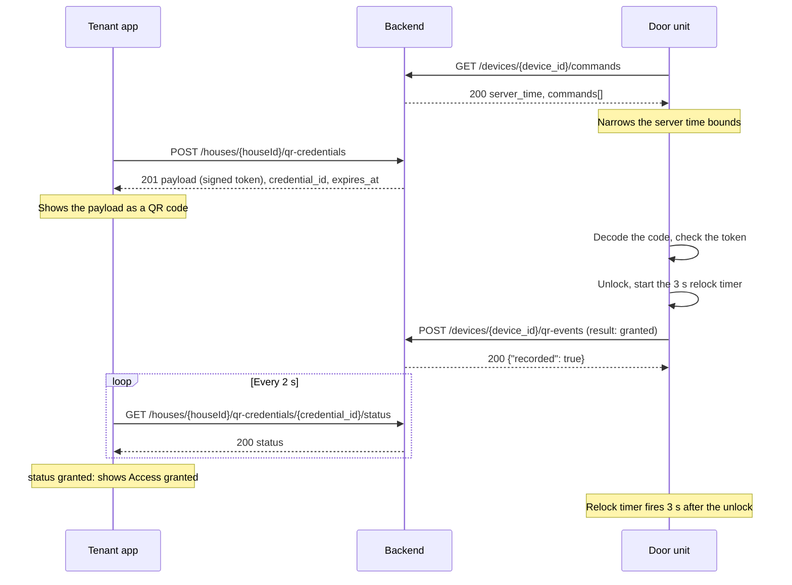

# QR access contract (v0)

This document defines how the door unit checks a signed QR credential by itself, decides whether to unlock, and reports the result to the backend. It's the firmware side of SCRUM-38. The backend issues each credential as a signed token, described in [API](../api.md#qr-credentials), and the app shows the token as a QR code. The [lock command contract](lock-command-v0.md) defines remote Lock and Unlock commands. QR access shares its lock controller (R9 to R12) and its report loop (R14).

- **Status:** implemented in `hardware/esp32/lib/ostium_core/` and wired into the board firmware. All 122 native tests pass, and both board builds compile. The [bench procedure](#bench-procedure) hasn't run on a board yet. For review by the firmware owners.
- **Version:** 0, November 16, 2026.
- **Applies to:** the door unit firmware in `hardware/esp32/`, with the Supabase `ostium-api` and `device-api` Edge Functions.

## Scope

This contract covers everything from one decoded QR text onward:

- The checks in `ostium_core`: the token's shape and signature, its claims, the door's unit, the server's time, single use, and the boot watermark.
- The grant or denial, and the unlock through `LockController`.
- The report to `POST /devices/{device_id}/qr-events`.
- The board wiring, the bench build's serial input, the tests, and the CI fixture check.

SCRUM-68 (Cameron) owns the camera, QR image decoding, the reader's buffer fix, and LCD or LED feedback. It merged the camera prototype into the door program as `board::AccessPanel` (`hardware/esp32/src/access_panel.cpp`). The camera now feeds `QrAccess` in both board builds: `board::CameraScanSource` hands each decode to it, and the panel's LCD shows each decision. The team has no lock yet, so an LED on the lock output stands in for the relay and lights for each unlock. The bench build also takes decoded text from Serial. [Camera handoff (SCRUM-68)](#camera-handoff-scrum-68) describes how the two connect, and the two steps that remain: a bench check that QVGA decodes a full token, and a real relay in the LED's place.

Out of scope for v0:

- A revocation or configuration feed. No backend route gives the door its unit, the public key, or revocations, so they're set at build time.
- An offline log buffer. Reports wait in RAM.
- Any backend or app change.

## How a QR scan travels

1. The door polls `GET /api/v1/devices/{device_id}/commands`, as in the lock command contract. Each good poll narrows the door's bounds on the server's clock. QR access needs at least one good poll since boot.
2. The tenant opens the QR screen. The app sends `POST /api/v1/houses/{houseId}/qr-credentials` and shows the returned `payload` as a QR code. The token lasts 60 seconds, or less when the tenant's grant ends sooner.
3. The camera task decodes the code and queues the text for the door's main loop. On the bench build, a `qr <token>` line on Serial is also a decode.
4. The door checks the token in the [decision order](#decision-order): its shape, the pinned header, the Ed25519 signature, the claims, the unit, the server time bounds, single use, the boot watermark, expiry, and issue time.
5. For a valid token, the door unlocks through `LockController`, which relocks after 3 seconds (R9).
6. The door posts one `granted` report to `POST /api/v1/devices/{device_id}/qr-events`.
7. The app polls the credential's status every 2 seconds. Once the backend has the `granted` report, the app shows **Access granted** and clears the code.



## The token

The backend's `signJWT`, in `backend/supabase/functions/_shared/api.ts`, writes a compact JWT: three base64url segments joined by dots. The door relies on these properties of it:

- The header is exactly `{"alg":"EdDSA","typ":"JWT","kid":"<QR_KEY_ID>"}`, as `JSON.stringify` writes it. For `ostium-qr-1`, its segment is the 63 characters `eyJhbGciOiJFZERTQSIsInR5cCI6IkpXVCIsImtpZCI6Im9zdGl1bS1xci0xIn0`.
- The claims are `iss`, `aud`, `sub` (the user's UUID), `unit_id`, `jti`, `iat`, and `exp`. `jti` equals `credentials.id`, and both UUIDs are lowercase. `iat` and `exp` are epoch seconds with up to 6 fractional digits, and the lifetime is at most 60 seconds.
- The signature is Ed25519 (RFC 8032) over the ASCII text `header.payload`. It's 64 bytes, so 86 base64url characters.
- The token has no device claim. The unit binds it to a door.

The fixture token in `backend/supabase/tests/python_compatibility.json` is 453 characters: a 63-character header, a 302-character payload, and an 86-character signature. At error correction level M, that needs about QR version 17 (85 by 85 modules).

## Configuration

The QR settings sit with the other door settings, as the lock command contract's [Configuration](lock-command-v0.md#configuration) describes. Leave either secret empty to turn QR access off.

| Setting | File | Default | Meaning |
|---|---|---|---|
| `OSTIUM_UNIT_ID` | `secrets.h` | `""`, which turns QR access off | This door's `units.id`, a UUID in either hex case. The door stores it in lowercase. It must equal `devices.unit_id` for `OSTIUM_DEVICE_ID`, or the backend answers every QR report with `403`. |
| `OSTIUM_QR_PUBLIC_KEY` | `secrets.h` | `""`, which turns QR access off | The backend's QR signing public key: the raw 32-byte Ed25519 key that matches `QR_SIGNING_PRIVATE_KEY`, base64url with no padding (43 characters). Never the test-only key from `python_compatibility.json`. |
| `OSTIUM_QR_KEY_ID` | `board_config.h` | `ostium-qr-1` | Must equal the backend's `QR_KEY_ID`. |
| `OSTIUM_QR_ISSUER` | `board_config.h` | `ostium` | Must equal `QR_ISSUER`. |
| `OSTIUM_QR_AUDIENCE` | `board_config.h` | `ostium-devices` | Must equal `QR_AUDIENCE`. |
| `OSTIUM_SERIAL_RX_BUFFER` | `board_config.h` | `2048` | The Serial receive buffer, in bench builds only. The 256-byte default loses most of a pasted 460-byte line while `loop()` waits on a request. |
| `OSTIUM_BENCH_TOOLS` | `esp32s3-bench` build flags | Defined only there | Turns on `qr <token>` input on Serial, and lets the door trust the test-only key. |

A `secrets.h` written before SCRUM-38 has no QR settings. `main.cpp` then defines both as `""`, so the build still compiles and QR access stays off.

To derive the public key from the backend's PEM private key, use OpenSSL 1.1.1 or later:

```sh
openssl pkey -in qr-signing-key.pem -pubout -outform DER | tail -c 32 | base64 | tr '+/' '-_' | tr -d '='
```

### Provision a door

1. Ask the backend owner to set `devices.unit_id` in the door's `devices` row to the unit's `units.id`.
2. In `secrets.h`, set `OSTIUM_UNIT_ID` to the same UUID, and `OSTIUM_QR_PUBLIC_KEY` to the derived key.
3. Leave `OSTIUM_QR_KEY_ID`, `OSTIUM_QR_ISSUER`, and `OSTIUM_QR_AUDIENCE` at their defaults, unless the backend's settings differ.
4. Flash the door, and check that the boot log shows `QR access on for unit <unit>, key <kid>`.

### When QR access stays off

At startup, `QrAccess::begin()` runs the [startup self-test](#startup-self-test) and checks the settings, in this order. The first failure logs `QR access off: <reason>`, and the door then denies every scan with `qr_disabled`.

| Reason in the log | Cause |
|---|---|
| `self-test failed` | The Ed25519 known-answer test failed on this board, so the verifier that every scan would use is broken. |
| `OSTIUM_UNIT_ID is empty` | No unit is set. |
| `OSTIUM_UNIT_ID must be the unit's UUID` | The unit isn't 36 characters in the 8-4-4-4-12 hex layout. |
| `OSTIUM_QR_PUBLIC_KEY is empty` | No key is set. |
| `OSTIUM_QR_KEY_ID or OSTIUM_QR_PUBLIC_KEY: <problem>` | The key ID is empty, over 64 characters, or has a character outside printable ASCII, or a space, `"`, or `\`. Or the key isn't 43 base64url characters that decode to 32 bytes, or it's all zero bytes (`public key is all zero bytes`) or another point of small order (`public key is a small-order point`). Under a small-order key, one fixed signature verifies over every message, so anyone could forge a token. |
| `OSTIUM_QR_ISSUER and OSTIUM_QR_AUDIENCE must be set` | Either is empty or over 64 characters. |
| `test-only QR public key outside the bench build` | The key is the fixture's test-only key, and the build doesn't define `OSTIUM_BENCH_TOOLS`. |

## Decision order

`QrAccess::handleScan(data, length, decodedAtMs)` is the only entry point for a decoded QR code. It first filters two cases, and decides nothing for them:

1. **Stale scan (Q1).** If the decode finished more than 2,000 ms ago, or is stamped later than now, the door ignores it with `stale_scan`, and logs `ignored stale QR scan (decoded <age> ms ago)`. The repeat memory doesn't change.
2. **Repeat (Q1).** If the text equals the last text that got a final decision, and less than 3,000 ms has passed since the door last saw it, the door ignores it with `repeat` and logs nothing. Each repeat restarts the 3,000 ms. Texts up to 768 bytes compare exactly. A longer text is always `malformed_qr`, so its first 768 bytes and its length are enough.

Then the door runs these checks in order, and the first failure wins (Q17). A *final* decision is remembered for the repeat filter. A *transient* one isn't, so the next decode, about 300 ms later, is checked again.

| # | Check | Reason | Rule | Final | Reported |
|---|---|---|---|---|---|
| 1 | `begin()` hasn't succeeded | `qr_disabled` | Q11 | Yes | No |
| 2 | The last poll got `401` | `device_refused` | Q11 | Yes | No |
| 3 | The text's shape is wrong | `malformed_qr` | Q2 | Yes | No |
| 4 | The header isn't the expected bytes | `unsupported_header` | Q3 | Yes | No |
| 5 | The signature doesn't strictly decode to 64 bytes | `malformed_qr` | Q2 | Yes | No |
| 6 | The signature doesn't verify | `bad_signature` | Q4 | Yes | No |
| 7 | The claims don't parse | `malformed_claims` | Q5 | Yes | No |
| 8 | `unit_id` isn't this door's unit | `wrong_unit` | Q7 | Yes | No |
| 9 | No usable server time bounds | `clock_unsynced` | Q10 | **No** | No |
| 10 | A claim value is wrong | `invalid_claims` | Q9 | Yes | Yes |
| 11 | The `jti` is in the revocation list | `revoked` | Q12 | Yes | Yes |
| 12 | The `jti` was already granted at this door | `already_used` | Q13 | Yes | Yes |
| 13 | Issued before the latest possible boot time | `issued_before_boot` | Q14 | Yes | Yes |
| 14 | `latest >= expMs` | `expired` | Q15 | Yes | Yes |
| 15 | `earliest - 500 < iatMs` | `not_yet_valid` | Q16 | **No** | No |
| 16 | The used list holds 32 IDs that the door can't forget yet | `used_list_full` | Q13 | Yes | Yes |
| 17 | The relock timer can't arm, so the door stays locked | `unlock_failed` | Q17 | Yes | Yes |
| 18 | Every check passed: the door unlocks, marks the `jti` used, and queues a `granted` report | Granted | Q17 | Yes | Yes |

The shape check (check 3) already admits only 86 base64url characters for the signature, so check 5 fails only when the unused low bits of the last character aren't zero. It runs after the header check, so a token with both a wrong header and such a signature gets `unsupported_header`.

Once the token passes checks 3 to 7, which include the slow signature check, the door reads its clock again. Checks 8 to 18 use that reading, so nothing slow runs between it and the unlock. After check 9, the door sets `occurred_at` to `earliest - 500 ms`. From there on, a denial can be reported. The door also forgets each used or revoked ID once `occurred_at` has reached the ID's expiry or retention time, and at least 61 seconds have passed on the door's own clock since it added the ID. [How the door uses the bounds](#how-the-door-uses-the-bounds) explains why it waits for both.

A failed unlock (check 17) doesn't mark the `jti` used, so the same code can work once the timer arms. A grant while the door is already unlocked doesn't extend the unlock (R10), but it still reports `granted`.

`QrAccess::handleScan` returns a `QrDecision`: `Granted`, `Denied`, or `Ignored`, with the reason, whether it's final, whether it queued a report, and the `jti` once the signature passed and the claims parsed.

### Reason codes

| Reason | When | Reported |
|---|---|---|
| `qr_disabled` | QR access is off: a setting is missing or invalid, or the self-test failed (Q11). | No |
| `device_refused` | The last poll got `401`, so the backend refuses this device (Q11). | No |
| `malformed_qr` | The text isn't a well-formed token (Q2). | No |
| `unsupported_header` | The header isn't the configured key's exact bytes (Q3). | No |
| `bad_signature` | The Ed25519 signature doesn't verify (Q4). | No |
| `malformed_claims` | The signed claims don't parse (Q5). | No |
| `wrong_unit` | The token is for another unit (Q7). | No |
| `clock_unsynced` | The door has no usable bounds on the server's clock (Q10). Transient. | No |
| `invalid_claims` | `iss`, `aud`, `sub`, an extra claim, or the lifetime is wrong (Q9). | Yes |
| `revoked` | The `jti` is in the revocation list (Q12). | Yes |
| `already_used` | This door already granted the `jti` (Q13). | Yes |
| `issued_before_boot` | The token was issued before the door started (Q14). | Yes |
| `expired` | The token may have expired (Q15). | Yes |
| `not_yet_valid` | The issue time isn't safely in the past yet (Q16). Transient. | No |
| `used_list_full` | The used list is full of IDs that the door can't forget yet (Q13). | Yes |
| `unlock_failed` | The relock timer couldn't arm, so the door stayed locked (Q17). | Yes |
| `stale_scan` | The decode is over 2,000 ms old (Q1). Ignored. | No |
| `repeat` | The same text arrived again within 3,000 ms (Q1). Ignored. | No |

### Log lines

Each decision writes one line, and never the token text, a token segment, a signature, or `sub` (Q20):

- `QR granted credential <jti>`
- `QR denied (<reason>) credential <jti>`, followed by `, reported` when the decision queued a report. This form is for checks 8 to 17.
- `QR denied (<reason>: <detail>), <length> bytes`, for checks 1 to 7. The detail is fixed text, such as `signature doesn't verify`, or the reason QR access is off.

## Rules the door follows

Each rule has unit tests in `hardware/esp32/test/test_core/`, with the names listed here.

| # | Rule | Tests |
|---|---|---|
| Q1 | The door handles a decoded QR only through `QrAccess::handleScan`, from `loop()`, through `drainScans` at most 4 at a time from each scan source, before and after each poll, and offline too. It ignores decodes over 2,000 ms old, or stamped later than now (`stale_scan`). After a final decision, it ignores the same text while it keeps arriving with gaps under 3,000 ms. Transient decisions aren't remembered. A camera decode is exactly its decoded bytes, and failed camera decodes are skipped. On the bench build, a `qr <token>` Serial line, ended by CR, LF, or CRLF, is also a decode. Right after each decision, `drainScans` shows its signal on the panel: `Granted`, `Denied` for a final denial, or `Wait` for a transient one. An ignored decode shows nothing. | `test_stale_scan_is_ignored`, `test_repeated_decodes_are_ignored`, `test_qr_scan_drain_is_bounded`, `test_serial_scan_lines_are_parsed`, `test_camera_decode_is_copied_exactly`, `test_qr_signal_follows_decision`, `test_qr_drain_shows_each_decision` |
| Q2 | The text must be at most 768 bytes of `[A-Za-z0-9_.-]`, with exactly two dots. The header can't be empty. The payload must be 1 to 512 characters, with `length % 4 != 1`. The signature must be exactly 86 characters that strictly decode to 64 bytes. base64url decoding is strict: no padding, and the unused bits of the last character must be zero. Otherwise: `malformed_qr`, not reported. | `test_malformed_qr_text_is_rejected`, `test_qr_demo_payload_is_rejected`, `test_base64url_decoding_is_strict`, `test_base64url_round_trips` |
| Q3 | The header segment must equal, byte for byte, the base64url of `{"alg":"EdDSA","typ":"JWT","kid":"<OSTIUM_QR_KEY_ID>"}`. Otherwise: `unsupported_header`, not reported. The door never parses unsigned JSON. | `test_qr_header_must_match_configured_key` |
| Q4 | Ed25519 (RFC 8032) over the exact received ASCII of `header.payload` must verify with `OSTIUM_QR_PUBLIC_KEY`, and S ≥ L is rejected. Otherwise: `bad_signature`, not reported. The door refuses a small-order public key at startup, because one fixed signature verifies under it over every message. | `test_forged_qr_is_rejected`, `test_qr_signature_matches_backend_fixture`, `test_ed25519_matches_rfc8032_vectors`, `test_ed25519_rejects_non_canonical_signature`, `test_ed25519_test_seed_derives_fixture_public_key`, `test_backend_qr_token_is_granted` |
| Q5 | Claims are decoded only after Q4. They must form a JSON object. `jti` and `unit_id` must be lowercase canonical UUID strings with no NUL. `iat` and `exp` must be finite JSON numbers between 2020 and 2100. Otherwise: `malformed_claims`, not reported. | `test_qr_claims_must_parse` |
| Q6 | `iatMs = ceil(iat × 1000) + 1` and `expMs = floor(exp × 1000) - 1`. Expiry is never rounded up, and issue time is never rounded down. | `test_qr_times_round_inward`, `test_backend_rejects_grants_outside_credential_window`, `test_backend_production_qr_token_is_granted` |
| Q7 | `unit_id` must equal `OSTIUM_UNIT_ID`. Otherwise: `wrong_unit`, not reported. The token has no device claim. The backend enforces the device-to-unit binding on reports (`403`). | `test_qr_for_other_unit_is_rejected` |
| Q8 | Only a scan that passes Q2 to Q7 and has known server time (Q10) can produce a report, so a forged or foreign token never names a credential. | `test_unverified_qr_never_reports` |
| Q9 | `iss` and `aud` must be strings equal to the configured values; an array `aud` fails. `sub` must be a non-empty string. There can be no claims beyond the seven. Also `expMs > iatMs` and `expMs - iatMs <= 60,000`. Otherwise: `invalid_claims`, reported. A future device claim (SCRUM-72) fails closed. | `test_qr_with_invalid_claims_is_rejected` |
| Q10 | Time comes only from `ServerClock` bounds ([Time model](#time-model)). With no good poll since boot, more than 72 hours since the last one, or a width over 30 seconds, the door denies with `clock_unsynced`: transient and not reported. `tick()` forgets the bounds before `millis()` can wrap. | `test_server_clock_bounds_use_request_and_response_times`, `test_server_clock_bounds_bracket_true_time`, `test_server_clock_combines_polls`, `test_server_clock_restarts_when_server_clock_moves`, `test_server_clock_stops_after_offline_limit`, `test_server_clock_forgets_bounds_before_millis_wraps`, `test_server_clock_survives_millis_wraparound`, `test_run_poll_feeds_server_clock`, `test_qr_denied_before_first_sync`, `test_qr_offline_validation_stops_at_limit` |
| Q11 | Cached configuration: QR access is off (`qr_disabled`) until `begin()` succeeds. That takes a valid unit, key, `kid`, issuer, and audience, the test-only key only with `OSTIUM_BENCH_TOOLS`, and a passing self-test of the verifier that every scan uses. After a poll gets `401`, the door denies with `device_refused` until a poll succeeds. Neither is reported. | `test_qr_disabled_without_valid_configuration`, `test_test_only_key_disabled_outside_bench`, `test_qr_denied_while_backend_refuses_device`, `test_qr_self_test_detects_bad_verifier`, `test_run_poll_feeds_server_clock` |
| Q12 | A `jti` in the cached revocation list is denied with `revoked`, reported. An entry stays until `occurred_at` (`earliest - 500 ms`) passes its retention time and at least 61 seconds have passed on the door's clock since it was added. Nothing fills the list until a backend feed exists. | `test_revoked_qr_is_rejected` |
| Q13 | A `jti` granted at this door is denied with `already_used` until `occurred_at` (`earliest - 500 ms`) passes its `expMs` and at least 61 seconds have passed on the door's own clock since the grant. So a restart that moves the time bounds backward while the door still holds the `jti`, after a poll from a slower instance ([assumption 5](#assumptions)) or a step in the server's clock, can't make a used code valid again. A restart after the door forgot the `jti` can, as [Known limits](#known-limits) describes. That includes a step during the code's life that the door saw only then, because it was offline or its polls failed. The list holds 32. A full list of IDs that the door can't forget yet gives `used_list_full`, and the door never drops one. Both are reported. | `test_qr_is_single_use`, `test_used_list_full_denies_new_credentials`, `test_used_qr_stays_used_when_server_clock_moves_back` |
| Q14 | `iatMs < bootTimeLatestMs` gives `issued_before_boot`, reported, so a reset can't clear single use. Codes issued in about the first second after boot are also denied. | `test_qr_issued_before_boot_is_rejected`, `test_power_cycle_cannot_replay_used_qr`, `test_server_clock_boot_time_is_latest_possible` |
| Q15 | `latest >= expMs` gives `expired`, reported. `latest` is read after the signature check, so a code that expires during the check is expired. | `test_expired_qr_is_rejected`, `test_backend_capped_qr_expiry_is_honored`, `test_backend_production_qr_window_boundaries` |
| Q16 | `earliest - 500 < iatMs` gives `not_yet_valid`: transient, not reported, and not remembered. | `test_fresh_qr_waits_until_issue_time_has_passed`, `test_backend_production_qr_window_boundaries` |
| Q17 | A grant calls `LockController::unlock()`, so R9 to R12 apply. It never extends an unlock in progress, but it still reports `granted`. If the relock timer can't arm, the door denies with `unlock_failed`, reported, and doesn't mark the `jti` used. Checks run in the [decision order](#decision-order), and the first failure wins. | `test_valid_qr_unlocks_and_reports_granted`, `test_qr_grant_does_not_extend_unlock`, `test_qr_unlock_failure_is_reported`, `test_qr_checks_report_first_failure_in_order` |
| Q18 | The report has exactly five fields. The event IDs are `qr-<jti>-granted` and `qr-<jti>-denied`. `occurred_at` is `earliest - 500 ms` in UTC milliseconds. Each credential gets at most one granted report per boot, unless the door first sees a step back in the server's clock after it forgot the code, as [Known limits](#known-limits) describes. It gets at most one denied report while the door remembers the denial, which is at least 120 seconds. A later denial reuses the event ID, so the backend keeps the first. | `test_qr_report_body_matches_contract`, `test_qr_report_time_is_inside_credential_window`, `test_qr_denial_reported_once_per_credential`, `test_backend_accepts_firmware_qr_report_bodies` |
| Q19 | QR reports use their own 8-entry queue and the [QR response table](#how-the-door-handles-each-response). There's one report post per loop pass in total, QR first. After a QR post that stays queued for a retry, command events go first until one posts, so failing QR reports can't starve them. A denial never evicts a grant. A failing report never blocks scans or lock control. | `test_qr_event_responses_follow_table`, `test_qr_denial_never_evicts_a_grant_report`, `test_one_report_post_per_pass_qr_first`, `test_failing_qr_reports_cannot_starve_command_events`, `test_qr_failed_report_does_not_block_scans`, `test_backend_qr_statuses_follow_response_table` |
| Q20 | Logs never contain token text, a token segment, or `sub`. | `test_qr_log_never_contains_token` |

## Time model

The door has no real-time clock. `ServerClock` keeps a lower bound (`earliest`) and an upper bound (`latest`) on the server's clock, and QR access takes time only from those bounds. Every successful poll narrows them, using the time the request started and the time the response arrived.

### Assumptions

1. The backend stamps `server_time` once per poll with `now()`, at the start of `GET /commands`. That's after the request leaves the door at local time A, read just before `fetcher.get()`, and before the response arrives at local time B, read after `get()` returns with the whole body.
2. `parseTimestamp` truncates the microseconds, so the true stamp is in `[S, S + 1)` ms.
3. Each response belongs to its own request. `HTTPClient` stops the client on any error, and `BackendClient::send` stops it after a bad body, so the door never reads a late response as the next one's.
4. The rates of `millis()` and the server's clock differ by at most 50 ppm of local elapsed time. `esp_timer` runs from the ESP32-S3's 40 MHz crystal, and the firmware uses no light sleep. Espressif's [ESP32-S3 hardware design guidelines](https://docs.espressif.com/projects/esp-hardware-design-guidelines/en/latest/esp32s3/schematic-checklist.html) call for a crystal within ±10 ppm, and 802.11 allows a station ±25 ppm in the 2.4 GHz band, the only band the ESP32-S3 has. The server's clock is NTP-disciplined. So 50 ppm leaves at least twice the Wi-Fi tolerance. This is an assumption about the parts: a working Wi-Fi link doesn't prove that the crystal meets either figure.
5. Device API instances agree within 500 ms.

### Arithmetic

All epoch times are `int64_t` ms. All local times are `uint32_t` ms, and differences use `uint32_t` subtraction, so they survive `millis()` wrapping.

```text
drift(e) = (uint64(e) * 50 + 999999) / 1000000         // ceil(e * 50 / 1e6)

onPollSucceeded(S, A, B):
  rtt      = B - A
  candLow  = S
  candHigh = S + 1 + rtt + drift(rtt)                  // +1 ms for truncation
  candBoot = S + 1 - A + drift(A) + 1000               // latest server time at millis 0, + 1,000
  if bounds exist and (B - anchor) <= 72 h:
      e    = B - anchor
      low  = max(low  + e - drift(e), candLow)
      high = min(high + e + drift(e), candHigh)
      if low > high:                                   // the server's clock was set
          log "server clock moved by about N ms ..."
          low = candLow; high = candHigh
          bootTimeLatest = max(bootTimeLatest, candBoot)
  else:
      low = candLow; high = candHigh
      bootTimeLatest = first poll since boot ? candBoot : max(bootTimeLatest, candBoot)
      log "server clock set (window N ms)"
  anchor = B; deviceRefused = false

bounds(L):
  no bounds, or (L - anchor) > 72 h:       false       // also catches L earlier than the anchor
  earliest = low  + e - drift(e)                       // e = L - anchor
  latest   = high + e + drift(e)
  latest - earliest > 30,000 ms:           false
  otherwise:                               true

tick(L): if (L - anchor) > 72 h, forget the bounds, and log it
```

- **Why the boot watermark is an upper bound.** The stamp happens after local time A, so the server's true time at A is less than `S + 1`. At least `A - drift(A)` of server time passed between local time 0 and A, so the server's time at boot was less than `S + 1 - A + drift(A)`. Taking the maximum on later restarts only makes the door stricter, which also covers a `millis()` wrap. The 1,000 ms margin is larger than the at most 2 ms that Q6 adds to `iatMs`. So a token whose true `iat` is before the boot always has `iatMs < bootTimeLatestMs`.
- **Narrowing.** Each poll's window is intersected with the bounds carried from earlier polls, so the width can drop below one round-trip time. With a steady server, the width tends to the shortest time from request start to stamp plus the shortest time from stamp to arrival, across polls, plus 1 ms.
- **A step in the server's clock.** If a poll's window doesn't overlap the carried bounds, the server's clock was set to another time, or the poll reached an instance whose clock differs (by up to 500 ms, assumption 5). The door restarts from that poll alone, and keeps the stricter boot watermark. The restart can move both bounds backward, so the door doesn't forget used or revoked IDs by `earliest` alone, as the next section explains.
- **Before `millis()` wraps.** `tick()` runs on every loop pass and forgets the bounds 72 hours after the last good poll. That's long before the 32-bit `millis()` wraps, after about 49.7 days.

### How the door uses the bounds

The door reads its clock twice for each scan. The stale and repeat filters use the time the scan arrived. The decision time `L` is a second `clock.nowMs()` reading, taken right after the signature check, the slow step. The bounds, `occurred_at`, the used list's hold, and the report all use `L`, and nothing slow runs between `L` and the unlock, so `latest` still bounds the server's time when the relay switches. The door never reads the bounds at the decode time, which makes `latest` stricter.

- **Expiry:** a grant needs `latest < expMs`.
- **Report time:** `occurred_at = earliest - 500 ms`.
- **Issue time:** a grant needs `iatMs <= occurred_at`.
- **Forgetting IDs:** the used and revoked lists forget an ID only once `occurred_at` has reached its expiry and at least 61 seconds (`kListHoldMs`) have passed on the door's own clock since the ID was added. `earliest` alone isn't enough. After a restart, the bounds can move backward, so `latest` can be before `expMs` again, and a `jti` forgotten under the old bounds could be granted a second time. The 61 seconds are the longest lifetime plus 1,000 ms for the skew between instances and for drift, measured on a clock that never steps, so they outlast every code's lifetime. Waiting for `occurred_at`, a time that every instance has reached, covers a step back that a poll shows the door while it still holds the ID: once the door forgets the ID, a poll from a slower instance can't move `latest` back before the expiry. Neither covers a step back that the door first sees after it forgot a code. The step can come later, or during the code's life while the door was offline or its polls failed, because the door forgets IDs by the bounds it holds. Either way, the step can make the code valid again, like any other code that expired within the step. See [Known limits](#known-limits).

### Why the backend accepts every report the door writes

| Backend `422` check | What the door guarantees |
|---|---|
| `occurred_at > now()`, with zero tolerance | `occurred_at <= T(decision) - 500 ms`, and the report arrives after the decision. The 500 ms covers skew between instances. |
| Granted and `occurred_at < issued_at` | `occurred_at >= iatMs = ceil(iat × 1000) + 1`, which is later than `issued_at` even after the double rounding of `Number(µs) / 1e6` (under 1 µs). For a production token, whose `iat` is a whole millisecond, `iatMs` is 1 or 2 ms after `issued_at`, because ArduinoJson's parse can land just above the exact value. `kQrGrantedBeforeIssue` shows that a truncated `iat` gets `422`. On the production clock, `kQrProdGrantedBeforeIssue` shows that `issued_at - 1 ms` gets `422`. The door's earliest `occurred_at`, `iatMs`, gets `200` in both cases: `kQrProdGranted` for a token whose `iatMs` is 2 ms after `issued_at`, and `kQrProdSecondGrantedEarliest` for one whose `iatMs` is 1 ms after it, the closest any door grant gets. |
| Granted and `occurred_at >= expires_at` | `occurred_at <= earliest <= latest < expMs = floor(exp × 1000) - 1 < expires_at`. `kQrGrantedAfterExpiry` shows that rounding `exp` up gets `422`. On the production clock, `kQrProdGrantedAtExpiry` shows that `expires_at` gets `422`, and `kQrProdGrantedLatest` that the latest `occurred_at` a door with a 0 ms round trip writes, `expMs - 502 ms`, gets `200`. |
| Granted and at or after `revoked_at` | The door can't know this, because no feed reaches it. The backend answers `422`, and the door drops the report and logs it. See [Known limits](#known-limits). |

### Worked example

A poll has A = 10,000, B = 10,300, and S = 12:00:01.123Z.

- At the anchor, `low = S` and `high = S + 1 + 300 + 1 = S + 302`.
- The boot watermark is `S + 1 - 10,000 + 1 + 1,000 = S - 8,998`.

A scan at L = 11,000 gives `e = 700` and `drift(700) = 1`:

- `earliest = S + 699`
- `latest = S + 302 + 700 + 1 = S + 1,003`
- The width is 304 ms.
- `occurred_at = S + 199 = 12:00:01.322Z`

### Offline and waiting

- **The offline limit.** At 72 hours, the drift is 12,960 ms on each side, so the width is the base width plus 25,920 ms. The bounds fail at 72 hours, or earlier when the base width after narrowing is over 4,080 ms, because the width cap is 30,000 ms.
- **What still works at the limit.** A 60-second code opens only between `iat + (true - earliest) + 500` and `exp - (latest - true)`. That's at least `60,000 - width - 502` ms: about 33.5 seconds at 72 hours with a 100 ms base. Online, the gap is a few hundred milliseconds.
- **After a reboot,** QR access waits until a poll succeeds.
- **After a `401` poll,** QR access stops until a poll succeeds.
- **A fresh code.** Online, a new code becomes acceptable about 0.5 seconds plus the current width after it's issued. The phone usually shows the code no sooner, and `not_yet_valid` is transient, so the next decode is checked again without the user moving the phone.

## Report a scan

After a grant, or a denial that the [decision order](#decision-order) marks as reported, the door sends:

```http
POST {OSTIUM_API_ROOT}/devices/{device_id}/qr-events
Authorization: Bearer <device token>
Content-Type: application/json
```

```json
{
  "event_id": "qr-55555555-5555-4555-8555-555555555555-granted",
  "credential_id": "55555555-5555-4555-8555-555555555555",
  "result": "granted",
  "reason": null,
  "occurred_at": "2026-10-22T12:00:00.623Z"
}
```

The door sends compact JSON with exactly these keys, in this order, and each body is under 250 bytes. The [example JSON files](examples/) hold a granted report, a denied report, and the backend's response.

| Field | Value |
|---|---|
| `event_id` | `qr-<jti>-granted` or `qr-<jti>-denied`. |
| `credential_id` | The token's `jti`, which is `credentials.id`. |
| `result` | `granted` or `denied`. For `granted`, the door turned on the lock output, or was already unlocked. |
| `reason` | `null` when `result` is `granted`, otherwise a [reason code](#reason-codes). |
| `occurred_at` | `earliest - 500 ms` at the decision, in UTC with milliseconds, ending in `Z`. |

### Event IDs

- The IDs come from the credential, so they're the same on every retry and after a reset.
- The boot watermark (Q14) means a `jti` granted before a reset can never be granted again, and within one boot the used list keeps a `jti` until the door's bounds show that its lifetime has passed (Q13). So a granted ID isn't reused with different content, except after a step back in the server's clock that the door first sees after it forgot the code, as [Known limits](#known-limits) describes.
- A denied ID sent again after a reset, or after the door forgets the denial, with a different `occurred_at` gets `409`, which the door treats as already reported.
- The `qr-` prefix keeps them apart from `evt-<command_id>`. Both kinds share the backend's per-device event ID namespace.

### How the door handles each response

| Response | What the door does |
|---|---|
| Any `2xx` | The report is delivered. The door removes it from the queue. |
| `409` | The backend already holds a report under this event ID. The door removes it. |
| `400`, `403`, `404`, `413`, `415`, or `422` | Retrying can't succeed. The door drops the report and logs the status. A `403` adds `check that devices.unit_id for this device equals OSTIUM_UNIT_ID`. A dropped grant also logs `backend refused a granted QR report; the access log lacks this unlock`. |
| `401`, `429`, `5xx`, a timeout, a network error, `3xx`, or any other status | The door keeps the report and retries it after 2, 4, then 8 seconds. |

Only `403` differs from the command [response table](lock-command-v0.md#how-the-door-handles-each-response). On `qr-events`, it means a device-to-unit binding mismatch, which retrying can't fix.

### The QR report queue

- QR reports wait in their own `EventOutbox`, built with `ReportKind::Qr`, which holds 8 reports. So QR traffic can never evict a command event.
- Grants can't be dropped to make room. Denials can.
- When the queue is full, a new report first evicts the oldest denial. With no denial queued, a new denial isn't queued (`event queue full, didn't queue <id>`), and a new grant evicts the oldest grant and logs it.
- `loop()` calls `reports.serviceOne(deviceClock)`, where `reports` is a `ReportScheduler` built with the QR queue first. That's at most one report post per loop pass across both queues (R14), with QR reports first, because the app waits on grants. A queue with nothing due gives the pass to the other.
- After a QR post that stays queued for a retry, command events go first until one posts. After a command post, QR reports go first again. So reports that keep failing in one queue, however slowly, can't starve the other: while QR posts keep failing, command events get at least every other post.
- Rows 1 to 9 of the decision order, and transient denials, are never reported. A forged or foreign token can never name a credential in a report.

## Timing and limits

| Constant | Value |
|---|---|
| Largest token, payload, and signature | 768 bytes, 512 characters, and exactly 86 characters |
| Header | Exactly the expected bytes: 63 characters for `ostium-qr-1` |
| Accepted claim times | 2020-01-01 to 2100-01-01 |
| Largest `kid`, issuer, and audience | 64 characters |
| Largest lifetime | 60,000 ms, after Q6 rounding |
| Stale scan age | 2,000 ms |
| Repeat quiet gap | 3,000 ms, restarted by each repeat |
| Scans per drain | 4 from each scan source, before and after each poll |
| Drift allowance | 50 ppm |
| Offline limit | 72 hours after the last good poll |
| Largest clock width | 30,000 ms |
| Boot margin | 1,000 ms |
| `occurred_at` margin | 500 ms |
| Used, revoked, and denial lists | 32 entries each |
| Used and revoked ID hold | At least 61,000 ms on the door's clock after the ID is added, and until `occurred_at` passes its expiry or retention time |
| Denial memory | At least 120,000 ms of server time |
| QR report queue | 8 reports, separate from the 8-event command queue |
| QR report retry backoff | 2,000, 4,000, then 8,000 ms for each report |
| Bench serial line | At most 1,024 bytes, ended by CR, LF, or CRLF; a longer line is discarded |

## Startup self-test

The door proves its own verifier before it trusts a scan. `QrAccess::begin()` runs `runQrSelfTest(kQrSelfTestToken, kTestOnlyQrPublicKey)` on the board, through the full `verifyQrToken` path, with the same verifier that every scan then uses. The firmware always uses the real one, `verifyEd25519`. The self-test checks these things:

- The fixture's token, signed by Python's `cryptography`, must verify with the exact `jti`, unit, and millisecond values, so the test also covers the ArduinoJson parse and the Q6 rounding on the target.
- A copy with one payload character changed, and a copy with one signature character changed, must each fail with a bad signature.
- If any check fails, QR access stays off with `self-test failed`.
- On success, the door logs `QR self-test passed; Ed25519 check took N ms`. N is the time of the fixture's own check: one Ed25519 verification and the claims parse, which is what one scan costs. The two changed copies run two more verifications, which aren't timed.

`main.cpp` then logs `loop stack: N bytes never used`. The self-test runs on the loop task's 8 KB stack, so that number covers the verifier's stack use. On the bench, N must be 100 ms or less, and at least 2 KB of stack must stay free. If N is higher, first add `-O2` to the build flags in `hardware/esp32/lib/monocypher/library.json`. If N is still over 200 ms, reimplement only `ed25519.cpp` with the board SDK's libsodium behind `#ifdef ARDUINO`, so the self-test and the native tests still check the same function.

The unit tests run the self-test with verifiers that accept every signature, reject every signature, ignore the message, or ignore the signature. Each must fail the self-test, and so must tokens that differ from the fixture only in `iat` or only in `exp`. The tests also give `QrAccess` verifiers that accept or reject every signature, and check that `begin()` then leaves QR access off with `self-test failed`.

The test vector is `hardware/esp32/lib/ostium_core/src/qr_test_vector.h`, generated from `backend/supabase/tests/python_compatibility.json`. It holds only the public key and the token, never the private key. Every build contains it, which is harmless, because nothing trusts the test-only key outside the bench build.

## Camera handoff (SCRUM-68)

The camera code hands decoded QR texts to the door through `ostium::ScanSource`, declared in `interfaces.h`, and the door shows each decision through `ostium::QrFeedback`, declared in `qr_access.h`. These steps are done:

1. `board::CameraScanSource : public ostium::ScanSource`, in `access_panel.h`, reads the camera's queue. Its `next()` calls `reader.receiveQrCode()` with a timeout of 0, so it never blocks, and it returns false until `AccessPanel::begin()` has started the camera.
2. It skips entries whose `valid` flag is false. Their payloads are quirc error strings, or `payload too long`.
3. It copies exactly `payloadLen` bytes, never using `strlen`, through `ostium::scanFromCameraDecode()` in `camera_scan.h`. That function also refuses a length below 0 or over the buffer's 1,023-byte capacity. It's in the core, so the native tests cover it.
4. The camera task sets `QRCodeData::decodedAtMs` to `millis()` when the decode finishes, before `xQueueSend`, so Q1 can drop decodes that waited in the queue during a blocked HTTPS call.
5. The reader no longer writes past its buffer. quirc can decode up to 8,896 bytes, but `QRCodeData::payload` holds 1,024, so `ESP32QRCodeReader.cpp` queues a decode over 1,023 bytes as a failed decode with the text `payload too long`, and clamps a failed decode's error text the same way. `payloadLen` is never more than 1,023. The reader's `setup()` also no longer sets GPIO 13 and 14 to `INPUT_PULLUP`. That was upstream's workaround for the ESP-EYE camera, behind `#if defined(CAMERA_MODEL_ESP_EYE)`, but `ESP32CameraPins.h` always defines that macro, so it ran on every board. On the door, it turned off the driver of the lock output, GPIO 14, after `LockController` had set it up (step 10).
6. `pumpScans()` in `main.cpp` drains the camera with `ostium::drainScans(cameraScans, qrAccess, 4, &accessPanel)` in both builds, and then, in the bench build, Serial the same way. The camera task never calls `QrAccess`.
7. The prototype's fixed-code check is gone: `processQr()`, the `AUTHORIZED_QR` comparison, its 5-second cooldown, and its payload print. The panel has no `delay()` calls. `QrAccess` suppresses repeats, and the relock is timer-driven.
8. Nothing logs a payload, because payloads are bearer credentials (Q20). The reader's debug output prints each payload, so it stays off: the door program never calls `setDebug()`.
9. `AccessPanel` implements `ostium::QrFeedback`. Right after each decision, `drainScans` passes `show()` the decision's `QrSignal`, from `qrSignalFor()`. Each LCD message lasts 3 seconds. The LED is the lock output (step 10), so it shows the unlock, not the decision.

   | Decision | Signal | LCD | LED (the lock output) |
   |---|---|---|---|
   | `Granted` | `Granted` | `ACCESS GRANTED`, `Welcome!` | On for the unlock, until the relock (R9) |
   | A final `Denied` | `Denied` | `ACCESS DENIED`, `Try again later` | No change |
   | A transient `Denied` (`clock_unsynced` or `not_yet_valid`) | `Wait` | `PLEASE WAIT`, `Show code again` | No change |
   | `Ignored` (`stale_scan` or `repeat`) | `None` | No change | No change |

10. R1 holds: `lockController.begin()` stays the first statement of `setup()`, and the camera GPIOs stay off `OSTIUM_LOCK_PIN`. The team has no lock yet, so the LED on GPIO 14 stands in for the lock relay: it's the lock output, `OSTIUM_LOCK_PIN`, and only `LockController` drives it. While `LED_PIN` in `access_panel.cpp` equals `OSTIUM_LOCK_PIN`, `kPanelDrivesLed` is false, so the panel never sets up or writes that pin, and its own LED patterns stay off. `AccessPanel::begin()` then logs `LED is the lock stand-in on OSTIUM_LOCK_PIN; LockController drives it.` So the LED lights for exactly each 3-second unlock, and goes off at the relock. If the panel's patterns drove the pin, a denial's three flashes would unlock the stand-in three times, and a grant's 2-second pattern would relock it before the unlock ended.

    The camera reader must not set up that pin either, so its ESP-EYE pull-up workaround is gone (step 5). Two more guards keep a library from leaving the lock undriven:
    - `GpioLockOutput::write()` makes the pin an output on every write, after it sets the level, not only on the first write.
    - `setup()` calls `lockController.lock()` after `accessPanel.begin()`, which drives the locked level again once the camera and sensors are set up.

    The native tests can't reach board code, so the [bench procedure](#bench-procedure) checks the pin with the camera running.

Two steps remain before the door unit goes on a real door:

1. **Check the decode on the bench.** A 453-byte token at error correction level M needs about QR version 17 (85 by 85 modules). Confirm that QVGA decodes it at the working distance, or raise the frame size in `access_panel.cpp`.
2. **Replace the LED with a real relay.** A relay module takes the LED's place on `OSTIUM_LOCK_PIN`. Once SCRUM-49 records the board's pinout, set `OSTIUM_LOCK_PIN` and `OSTIUM_LOCK_ACTIVE_HIGH` for the relay, as the [board README](../../hardware/esp32/README.md#build-and-flash-the-board) describes. If the panel then gets its own indicator LED on another GPIO, with `LED_PIN` set to that GPIO, its LED patterns turn back on: on for 2 seconds for a grant, and three flashes for a final denial.

## Testing

- **Unit tests:** `pio test -d hardware/esp32/native-tests`, run from the repository root, runs the Q1 to Q20 tests with the R1 to R16 tests, 122 in all. The QR tests are in `test_ed25519.cpp` (3), `test_qr_token.cpp` (9), `test_server_clock.cpp` (9), `test_qr_access.cpp` (28), `test_event_outbox.cpp` (5 of its tests), `test_serial_scan.cpp` (1), `test_camera_scan.cpp` (3), and `test_qr_backend_replay.cpp` (7). For details, see [Testing](../testing.md#firmware-unit-tests).
- **Crypto:** Ed25519 is Monocypher 4.0.2, vendored unmodified in `hardware/esp32/lib/monocypher/`, so the native tests and the board run the same verifier, with no package to install. The tests check it against the RFC 8032 vectors, and sign with the fixture's seed to reproduce the backend's signature byte for byte.
- **Replay tests:** `hardware/esp32/tools/capture_qr_backend.ts` runs the real `createHandler` from the Deno backend in process. It issues credentials, polls, and posts the firmware's report bodies, and records the tokens and statuses in `hardware/esp32/test/test_core/qr_backend_responses.h`. It records two sets:
  - The first runs on a microsecond clock, so no time falls on an exact millisecond, and the tool rounds the claims exactly.
  - The production-clock set runs on `createHandler`'s default clock, `BigInt(Date.now()) * 1000n`, as `device-api` does, so every time is a whole millisecond, as in real tokens. The tool computes its Q6 values the way the firmware does: ArduinoJson's parse of the claim text, then IEEE double arithmetic. That parse isn't always the nearest double, so `Math.ceil(Number(text) * 1000) + 1` would give the wrong `iatMs` for about 63% of whole-millisecond times in 2026, including `1792670400.123`. The set records a grant of each token at the earliest `occurred_at` the door writes, 2 ms and 1 ms after `issued_at`, and of one at the latest. It also records the backend's answers 1 ms before `issued_at` and at `expires_at`. The tool copies the parse of ArduinoJson 7.4.3, which the three build files pin exactly. The tool fails if a build file names another version, and the replay tests don't build against another release.

  The tests in `test_qr_backend_replay.cpp` run those through the core. To record them again after a change to the QR routes, the device routes, or `python_compatibility.json`, run this from the repository root:

  ```sh
  deno run --check --allow-read --allow-write=hardware/esp32/test/test_core,hardware/esp32/lib/ostium_core/src hardware/esp32/tools/capture_qr_backend.ts
  ```

- **Fixture check:** the `firmware-test` CI job runs the tool with `--check`. It writes nothing, and fails if either generated header is out of date:

  ```sh
  deno run --check --allow-read hardware/esp32/tools/capture_qr_backend.ts --check
  ```

- **Bench:** see [Bench procedure](#bench-procedure).

## Bench procedure

Use the `esp32s3-bench` build with the real backend, and record the results in [Bench results](#bench-results).

1. **Provision the device.** Ask the backend owner to set `devices.unit_id` for the door to the unit's `units.id`. Confirm that the deployed `device-api` includes `qr-events`. Otherwise, every report gets `404` and the door drops it.
2. **Configure the door.** Derive the public key with the [OpenSSL command](#configuration), and set `OSTIUM_QR_PUBLIC_KEY`, `OSTIUM_UNIT_ID`, and `OSTIUM_API_ROOT=https://<ref>.supabase.co/functions/v1/device-api/api/v1`.
3. **Flash the door and check the boot log.** Run `pio run -d hardware/esp32 -e esp32s3-bench -t upload -t monitor`. Expect `QR self-test passed; Ed25519 check took N ms`, `QR access on…`, `loop stack: N bytes never used`, and, after the first poll, `server clock set (window N ms)`. Record each N.
4. **Issue a token as the app's user.** Run this, and paste the line it prints into the serial monitor within 60 seconds:

   ```sh
   curl -s -X POST "https://<ref>.supabase.co/functions/v1/ostium-api/api/v1/houses/$UNIT_ID/qr-credentials" \
     -H "Authorization: Bearer $USER_TOKEN" | python3 -c 'import json,sys; print("qr " + json.load(sys.stdin)["payload"])'
   ```

5. **Check the grant.** Expect `QR granted credential <jti>`, the relay on for 3 seconds, and `event qr-<jti>-granted delivered`. `GET …/houses/$UNIT_ID/qr-credentials/<jti>/status` must return `"status":"granted"`. Until a relay replaces it, the LED on GPIO 14 is the relay: check this with the camera running, after `Camera initialized.` in the boot log. These readings are for the default `OSTIUM_LOCK_ACTIVE_HIGH` of `1`.
   - After boot, the LED is off, and a meter on GPIO 14 reads 0 V.
   - For the grant, the LED lights for 3 seconds, and the meter reads about 3.3 V. The LED then goes off at the relock, and the meter reads 0 V again.
   - Send an Unlock command from the app, and expect the same 3-second LED and readings.

   A dim glow at boot, or no light for a grant that the log shows, means something turned off the pin's output driver ([camera handoff](#camera-handoff-scrum-68), step 10).
6. **Check the denials:**
   - Paste the same line again after 3 seconds: `already_used`, reported.
   - Paste it about 70 seconds after the grant: `expired`, not reported again. Until 61 seconds after the grant, it's still `already_used`, also not reported again.
   - Change one signature character: `bad_signature`, not reported.
   - Use another unit's token: `wrong_unit`, not reported.
   - Paste the app's demo payload: `malformed_qr`.
7. **Check offline behavior.** After a good poll, turn the access point off, and paste a fresh token issued over another network. Expect a grant, and the report delivered after the access point returns.
8. **Check behavior after a restart.** Restart the door with the access point off, and expect `clock_unsynced`. Then turn the access point on, and confirm that a token issued before the restart gives `issued_before_boot`.
9. **Check device refusal.** Ask the backend owner to set the device's status to `disabled`. Expect `backend refused this device (401); QR access paused until a poll succeeds`, and then `device_refused` for each scan.
10. **Record the build size.** Put the RAM and flash figures from `pio run` in [Door unit design](design.md#testing).

### Bench results

| Measurement | Requirement | Result |
|---|---|---|
| Ed25519 check time for one check, from `QR self-test passed` | 100 ms or less | Not measured yet |
| Free loop stack, from `loop stack` | At least 2 KB | Not measured yet |
| First clock window, from `server clock set` | None; for the record | Not measured yet |
| Steps 5 to 9 | As listed | Not run yet |

## Known limits

- A photographed code used before its owner uses it, within its 60 seconds or less, opens the door once. Single use and expiry limit this but can't prevent it.
- No revocation or configuration feed exists. A revoked grant or credential opens the door until it expires. The backend then answers the granted report with `422`, which the door drops, so the access log has a gap.
- Single use is per door. On a unit with several doors, one code can open each door once.
- After a reboot, QR access waits until a poll succeeds. Offline validation stops 72 hours after the last good poll. Late in that window, codes open only during the middle of their lifetime: about 33 of their 60 seconds at 72 hours.
- The 50 ppm assumption relies on a crystal within Espressif's ±10 ppm requirement, or at worst the 802.11 tolerance of ±25 ppm. A badly out-of-spec clock could accept a code late during a long offline period.
- A step back in the server's clock that's larger than the time since a code expired makes that code valid again, until the server's time passes its expiry again. A code that was never used can then open the door once. A used code stays used for at least 61 seconds after the grant and until `occurred_at` passes its expiry. So a step back that a poll shows the door while it still holds the code can't reopen it, even when a slower instance answers a later poll. A step that the door first sees after it forgot the code can. That step can come after the door forgot the code, or during the code's life while the door was offline or its polls failed. In the second case, once the hold has passed, any scan of a code for this unit with a good signature makes the door forget the used code under its old bounds, and the next poll moves the bounds back. `test_used_qr_stays_used_when_server_clock_moves_back` shows it. The code's second `granted` report reuses the event ID with a different `occurred_at`, so the backend answers `409`, and the access log lacks the second unlock.
- Reports wait in RAM. A reset loses them, and more than 8 grants during an outage evict the oldest grant.
- Any backend change to the header bytes, the `kid`, the issuer, the audience, the claim set, or a lifetime over 60 seconds denies every QR code until the firmware is updated. That's deliberate fail-closed behavior, and the CI fixture check catches it. SCRUM-72's device claim needs a firmware update first.
- A wrong `OSTIUM_UNIT_ID` denies every scan with `wrong_unit`. A wrong `devices.unit_id` makes every report get `403`. Only the logs and the provisioning steps guard against this.
- Time trust rests on TLS, and Arduino-ESP32 2.0.17 doesn't check certificate dates. The bench build's plain HTTP lets anyone on the network forge `server_time`.
- While `loop()` is blocked in HTTPS, decodes wait, and the door drops those over 2 seconds old as stale. A request normally takes a few hundred milliseconds. On the reused connection, the configured limits allow about 9 seconds: 3 for the response headers and 6 for the body. A request that opens a new connection, as the first one after any error does, adds 3 seconds to connect and 3 for the TLS handshake, for about 15 seconds, plus DNS, which Arduino-ESP32 2.0.17 allows up to 15 seconds. The header limit restarts with each header line, and the handshake limit is checked only between reads, so a server that sends data slowly can hold the loop longer.
- Clock skew over 500 ms between device API instances can make the backend answer a granted report with `422`.
- The test-only public key and token are compiled into every build for the self-test. That's harmless, because nothing trusts the key outside the bench build.
- `hardware/esp32/tools/capture_backend_responses.py` still targets the removed FastAPI backend, so the command replay fixtures can't be recorded again. The QR fixtures come from the Deno backend.
