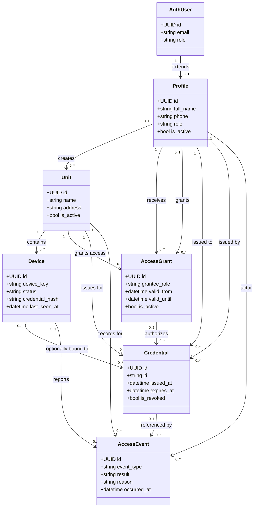
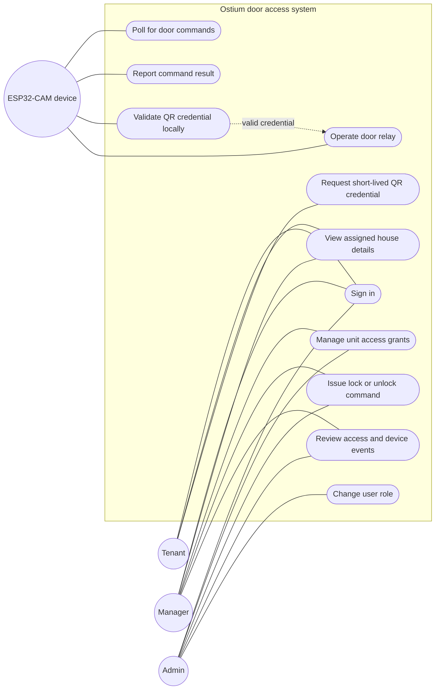

# Ostium MVP Implementation Report

**Project:** Ostium smart door access system  
**Report date:** 2026-10-24  
**Purpose:** Summarize the selected architecture, MVP scope, design changes, test plan, CI pipeline, and implementation challenges.

## 1. Executive Summary

Ostium is a shared Expo application, a FastAPI service, a Supabase Auth/Postgres data platform, and an ESP32-CAM door device. The system is designed so the backend issues identities, access grants, signed short-lived QR credentials, and remote commands, while the device makes the immediate credential-validation and relay decision locally. HTTPS polling and reports synchronize devices with the service without requiring MQTT or a continuously available connection during local credential validation.

The project began with a FastAPI + SQLite design. The implemented backend now uses Supabase Auth and Postgres behind FastAPI. The project contains backend APIs and tests for signup/login, role checks, QR credential issuance, remote lock/unlock commands, device command polling, and event reporting. The Expo app shares routes and components across mobile and web. Important integration gaps remain: the app QR screen is configured to display a placeholder rather than request a real credential, the app's sample house IDs are not connected to backend unit IDs, and the manager house-access screen is not yet backed by persisted API access grants.

## 2. Architecture and Design Rationale

### 2.1 Selected architecture

The architecture is a small modular service system with four main boundaries:

- **Expo client:** One Expo Router / React Native codebase serves iOS and Android tenants and the browser-based manager experience. Shared UI and API client code reduce duplicated behavior.
- **FastAPI:** A modular monolith owns the HTTP boundary, user authentication/profile checks, role authorization, QR issuance, remote door commands, and device reports. Centralizing policy allows the backend to enforce authorization independently of client visibility.
- **Supabase:** Supabase Auth manages user identity and sessions; Supabase Postgres stores profiles, units, devices, access grants, credentials, and access events. The FastAPI Supabase client keeps the service key on the server.
- **ESP32-CAM:** Arduino firmware scans QR codes, verifies credentials locally, keeps the configuration/revocation state needed for offline checks, controls the relay, polls commands, and reports command outcomes.

User traffic and device traffic both use HTTPS, but use different credentials and authorization paths. A user bearer token is validated with the active profile and its role. Devices use a device-specific bearer credential verified against its stored hash. Manager/admin operations require server-side role checks. The ESP32 is the enforcement point for physical unlocking; a backend response alone does not move the relay.

### 2.2 UML class diagram

The class diagram is based on the current Supabase schema. `AuthUser` is the Supabase Auth identity; `Profile` adds Ostium-specific role and activation state.



`AccessGrant` models who may use a unit and during which interval. `Credential` records a short-lived token and revocation state; the signed token is bound to its subject and unit, and may reference a grant or device. `AccessEvent` is the audit/synchronization record for scans, device state, commands, and reports. The exact relational constraints are defined in [`backend/supabase/000_initial_schema.sql`](../backend/supabase/000_initial_schema.sql).

### 2.3 UML use-case diagram

The use-case view includes the current service behavior and labels the mobile QR request as not yet integrated in the UI. Mermaid Markdown does not define a portable native UML use-case diagram type, so this flowchart uses actor nodes, an explicit system boundary, and oval use-case nodes to preserve preview rendering.



### 2.4 Rationale and key design choices

- **One client codebase:** Expo Router and React Native Web allow mobile and web experiences to share domain types, components, validation, and API behavior. This suits a small team and avoids a second frontend implementation.
- **FastAPI as a policy boundary:** User roles and device credentials are checked server-side. Client-side route visibility is a usability feature, never the security control.
- **Supabase Auth and Postgres:** Delegating identity and hosted relational persistence avoids implementing password storage, token lifecycle, and database hosting in the MVP. The Supabase service key remains backend-only.
- **Local device enforcement:** Door opening must not depend on a round trip to the cloud. A valid signed QR can be checked against local public-key/configuration/revocation state; synchronization can resume when connectivity returns.
- **HTTPS polling rather than MQTT:** Periodic polling and event posts are easier to operate and test for this MVP, avoid another broker/service, and match the documented device command/report APIs.
- **Short-lived, signed QR tokens:** Expiry, JTI, user/unit binding, issuer/audience, and signature checks reduce the impact of copied QR images. Grant expiry caps credential expiry.
- **Explicit data contracts and error handling:** Strict request models, token separation, idempotent event reporting, and clear HTTP failure classes make retries and failures testable.

## 3. MVP Feature Subset

The MVP is the smallest vertical slice that exercises identity, authorization, access policy, device interaction, and auditability without claiming full production integration.

### Included in the implemented backend

- Signup and login through Supabase Auth, returning the client-compatible token/user shape.
- Profile/role lookup and admin-only role changes; new signups are tenants.
- Active user/profile checks and role restrictions.
- Short-lived Ed25519-signed QR credential issuance for active units and valid tenant grants; credentials are persisted before being returned.
- Manager/admin lock/unlock command issuance with a short expiry.
- Device-specific authentication, command polling, and event/result reporting.
- Idempotent event retries and rejection of conflicting retries.
- Supabase Postgres schema for profiles, units, devices, grants, credentials, and access events.

### Included in the shared app or prototype

- Shared Expo Router application for iOS, Android, and web.
- Tenant and manager login roles, session persistence, validation, settings, and QR screen layout.
- Demo/sample house records and a manager house screen prototype.
- QR placeholder display while live credential integration is not enabled.

### Deliberately deferred or not yet end-to-end

- Connecting sample house IDs to persisted Supabase unit IDs and real user grants.
- Persisting manager add/remove access actions through backend grant endpoints; the current prototype's local demo access state is not the production source of truth.
- Enabling the app's live QR credential request; the QR screen currently uses a placeholder.
- Full manager workflows for guest access, revocation UI, logs, live device telemetry/camera viewing, and unit management.
- End-to-end hardware validation of signed QR tokens and relay operation on physical boards.
- MQTT, Redis, background jobs, push notifications, an ORM, or a separate web application.

This subset was chosen because it demonstrates the security-critical paths and provides independently testable API contracts while limiting deployment and hardware dependencies. UI-to-backend and physical hardware work can be completed incrementally without changing the central trust boundary.

## 4. Changes from Part A Design

Part A's original architecture and requirements describe FastAPI + SQLite (`sqlite3`), with a later possible PostgreSQL migration. The implementation now uses FastAPI as a modular service over Supabase Auth and Supabase Postgres. The database therefore moved to Postgres earlier than originally planned, and identity management moved to Supabase Auth rather than a custom SQLite-backed user/auth subsystem.

The device API also evolved. Part A describes polling a generic device config endpoint and posting access/doorbell events. The implemented API adds a queued remote-command contract: managers/admins issue lock/unlock commands, devices poll a command endpoint, and devices report command results. QR credentials are signed and persisted, with grant checks and expiry limits. This extends the original access-event concept to support acknowledged remote commands without making the device's local QR validation depend on the backend.

The overall structural choices remain: one Expo Router application for native and web, one FastAPI service boundary, HTTPS device communication, and local device enforcement for offline operation. The architecture documentation has been updated to reflect Supabase; [`docs/requirements.md`](requirements.md) still contains the original SQLite wording and should be reconciled in a future documentation pass.

## 5. Test Plan

The test plan is layered so security rules and failure behavior can be checked cheaply without live credentials, a running Supabase project, or physical hardware.

### Backend unit and API integration tests

Run from `backend/` with the declared requirements installed:

```sh
python -m unittest discover -s tests -v
```

`unittest.IsolatedAsyncioTestCase` drives FastAPI through `httpx.ASGITransport`. Supabase rows and transport calls are replaced by an in-memory stand-in or mocked HTTP client. Important coverage includes:

- Signup confirmation-required responses, session responses, malformed upstream responses, and CORS response headers.
- Authentication failures, inactive/missing profile behavior, tenant-vs-manager/admin authorization, and admin-only role updates.
- Command request validation, command expiry, device isolation, repeated polling, and acknowledgement behavior.
- Device token verification, disabled/provisioned/offline device status handling, and cross-device command/report isolation.
- Idempotent event retries, concurrent duplicate reports, conflicting retries, timestamp validation, and controlled upstream failures.
- QR signature verification, JWT claims, persistence-before-response, active-unit checks, grant validity boundaries, grant-capped expiry, and signing/persistence failures.

Representative test pattern from `backend/tests/test_access.py`:

```python
async def test_user_authorization_and_role_change(self):
    self.store.profile["role"] = "tenant"
    response = await self.request(
        "POST", "/doors/front/commands", json={"action": "unlock"}
    )
    self.assertEqual(response.status_code, 403)

    self.store.profile["role"] = "admin"
    response = await self.request(
        "POST", f"/auth/users/{USER}/role", json={"role": "tenant"}
    )
    self.assertEqual(response.status_code, 200)
```

A high-value property for credential issuance is: a tenant can receive a credential only for an active unit while holding a currently active grant, and the token expiry never exceeds either the configured credential lifetime or the grant expiry.

### Frontend unit tests

Run from `application/` with Bun 1.3.14 or newer:

```sh
bun install --frozen-lockfile
bun run test
bun run test:typecheck
```

The repository-root `tests/frontend/` suite covers pure utilities and service/controller behavior, not screen-level rendering or native hardware. It tests validation, auth response parsing, API methods/error mapping, session expiry and persistence parsing, QR credential shape/expiry, and QR request lifecycle behavior using mock fetches, deterministic clocks, and simulated timers.

Representative QR controller test pattern:

```typescript
test('does not accept an expired or wrong-house credential', async () => {
  const controller = new QRCredentialController(
    async () => credential('another-house', 'stale', 1000),
    () => 1000,
  );
  controller.activate('house-1');
  await settle();
  expect(controller.getSnapshot().credential).toBeNull();
  expect(controller.getSnapshot().error).not.toBeNull();
});
```

### Firmware and manual integration tests

The CI plan builds the ESP32-S3 board targets and runs native PlatformIO unit tests. Hardware acceptance should separately verify camera scanning, Ed25519 signature/claim checks, expiry and replay handling, relay behavior, cached revocation behavior while offline, synchronization after reconnect, and command deduplication. These require the board, provisioned test records/keys, and a safe relay test fixture; they are not proven by mocked backend tests.

### Test output placeholders

**Populate these from the actual MVP/GitHub Actions run before submission. No results are asserted in this draft.**

- Backend tests: `[PASTE COMMAND, DATE/COMMIT, PASS/FAIL/SKIP COUNTS, AND RELEVANT OUTPUT]`
- Frontend tests and typecheck: `[PASTE COMMAND, DATE/COMMIT, PASS/FAIL/SKIP COUNTS, AND RELEVANT OUTPUT]`
- Firmware build and native tests: `[PASTE PLATFORMIO COMMANDS, BOARD/TARGET, TEST COUNTS, AND RELEVANT OUTPUT]`
- Web/mobile smoke test: `[RECORD PLATFORM, BUILD/START RESULT, AND QR PLACEHOLDER / AUTH FLOWS VERIFIED]`
- CI run URL and commit: `[PASTE GITHUB ACTIONS RUN URL AND COMMIT SHA]`

## 6. Continuous Integration in GitHub

A three-stage GitHub Actions workflow was implemented historically in commit `646f769` on the `scrum-53-github-actions` branch. It used dependency/build jobs, test jobs gated on all builds, and an auto-merge job gated on all tests. The workflow definition is not present in the current `main` tree: current Git history includes commit `eecbe4c` removing earlier workflow files, and the later three-stage workflow is on a branch that is not merged into current `main`. Therefore, the stages below describe the implemented historical CI design, not an active guarantee on the current branch.

### Build stage

Three jobs ran in parallel on Ubuntu:

- **`firmware-build`:** Install pinned PlatformIO; build the ESP32-S3 application and bench targets.
- **`backend-build`:** Install `backend/requirements.txt`, compile backend/test Python files, and import the FastAPI application.
- **`frontend-build`:** Install pinned Bun dependencies from the frozen lockfile, create the generated Expo type reference where needed, and run `bunx tsc --noEmit`.

### Test stage

The firmware, backend, and frontend test jobs each declared all three build jobs in `needs`, so they started only after every build passed:

- **`firmware-test`:** Run PlatformIO native tests and upload a JUnit artifact.
- **`backend-test`:** Run `python -m unittest discover -s tests -v` in `backend/`.
- **`frontend-test`:** Run frontend typecheck and Bun tests; upload JUnit output as an artifact.

### Merge stage

The **`auto-merge`** job waited for all three test jobs. It only ran for a non-draft, same-repository pull request targeting the default branch. It used GitHub CLI with `--match-head-commit` to prevent merging a stale commit; repository settings had to permit auto-merge and merge commits. The workflow also used concurrency cancellation so a newer push cancelled an older run.

The trigger set included pull request open/synchronize/reopen/ready-for-review events, pushes to `main`, and manual dispatch. The exact workflow and its detailed setup are available from the historical commit `646f769`; current active status must be re-established by restoring/merging a workflow and confirming a successful run on `main`.

## 7. Implementation Challenges and Responses

- **Initial database choice changed:** The Part A SQLite plan was superseded by Supabase Auth/Postgres. The backend now wraps Supabase calls behind FastAPI, preserving a single policy/API boundary and making account/profile lifecycle available without a custom auth database. The report records both states rather than conflating them.
- **Backend and hardware can be unavailable:** QR issuance and device operation cannot assume constant connectivity. The ESP32 is designed to validate signed credentials from local trusted state; command polling/reporting is a separate synchronization channel.
- **Credential security is more than encoding a QR:** Tokens need signatures, short lifetime, JTI, issuer/audience and unit binding; tenants need valid grants; expired/revoked credentials must not unlock. Backend tests verify the signed token and persistence contract, while firmware validation remains a separate hardware/integration obligation.
- **Retries can race:** Device polling repeats commands, and event reports may be retried concurrently. Deterministic event IDs, exact-payload comparison, and collision handling make exact retries idempotent while conflicting reuse returns an error.
- **Shared mobile/web constraints:** Native and browser storage/navigation differ. The app isolates storage behind platform-specific services and shares the Expo Router codebase, but existing service tests do not replace browser/native end-to-end testing.
- **Branch and dependency drift:** The current Expo Go version and the project's SDK must be compatible; switching branches can also leave `node_modules` inconsistent with the selected manifest. SDK alignment and a clean dependency install are needed after a branch/SDK switch.
- **CI status is branch-dependent:** A CI workflow was authored and then removed/replaced across branch history. The current main branch must be checked for an active workflow rather than assuming the historical auto-merge process still runs.
- **Documentation drift:** Original requirements/security notes still mention SQLite in places although the backend uses Supabase. The architecture text was updated to state the implemented design, and the stale requirements/security references remain identified for cleanup.

## 8. Current Limitations and Follow-up

1. Connect sample houses to actual `units` and access-grant API data.
2. Enable the QR screen to call the real credential endpoint and remove placeholder-mode gating only after end-to-end testing.
3. Persist manager grant/revoke changes through authenticated backend routes with server-side role checks.
4. Complete firmware verification and relay tests using a physical board and provisioned test credentials.
5. Restore or merge active GitHub Actions workflows to `main`, then capture a successful full pipeline run for the test-results section.
6. Reconcile `docs/requirements.md` and `docs/security.md` with the Supabase-backed implementation.

## 9. Source Documents

- [Architecture and UML](architecture.md)
- [Original requirements](requirements.md)
- [API contracts and walkthrough](api.md)
- [Testing strategy](testing.md)
- [Security notes](security.md)
- [Backend setup and endpoints](../backend/readme.md)
- [Supabase schema](../backend/supabase/000_initial_schema.sql)
- Historical CI workflow: commit `646f769` (not present on current `main`)
